# 2026-10-22 技术新闻解读

> 按原始素材整理新闻背景、解读问答与截图，保留引用链接；未额外核验新闻事实。

## 目录

1. [PHP2Shell：AI 辅助发现与互联网级补丁协同](#news-01) — 12 组问答
2. [Flint 与自动化研究：本地代码模型、更小型团队与科研工作流](#news-02) — 12 组问答
3. [推理系统：DeepInfer 的经济性、原生 TPU 支持与电力约束下的算力扩展](#news-03) — 6 组问答
4. [评测可信度与智能体工程：衡量运行框架，而不只是模型](#news-04) — 6 组问答
5. [智能体产品、检索模型与 API 分发](#news-05) — 5 组问答
6. [行业与治理：研究人员的言论与公共利益监督](#news-06) — 2 组问答
7. [DeepSeek 新动态：DeepInfer（活跃度：441）](#news-07) — 1 组问答
8. [EAGLE-4 发布：比 DFlash2 和 DSpark 更快（活跃度：306）](#news-08) — 2 组问答
9. [现在看来，之前那篇“3090 抢购潮”预警帖终于说得通了。（讨论热度：405）](#news-09) — 1 组问答
10. [ornith-ai/Ornith-1.5-122B（Qwen 微调版）｜活跃度：438](#news-10) — 1 组问答
11. [RecursiveSI/flint（40B 总参数，2.5B 激活参数）· Hugging Face（活跃度：784）](#news-11)
12. [支持声音克隆的 Pocket TTS，如今仅需190万参数（热度：561）](#news-12) — 1 组问答
13. [独家：字节跳动、阿里巴巴和腾讯下单采购超过350亿美元的英伟达芯片（活跃度：1047）](#news-13) — 1 组问答
14. [做好准备，GPU 即将涨价：三星 2027 年的 HBM 产能已全部售罄，预计明年 HBM 价格上涨 200%，DRAM 价格出现两位数涨幅（活跃度：1…](#news-14)
15. [Claude Duet：Anthropic 不声不响地推出了个人助理，称其为“主动式智能体”。这是对 Muses、Bots 和 Dots 的回应。（活跃…](#news-15)
16. [我用 Claude 修好了三星电视（活跃度：3894）](#news-16)
17. [技术新闻 17](#news-17)
18. [我把一个包含1100万篇新闻文章的数据库交给 Claude Code，它发现了一些奇怪的规律（活跃度：1604）](#news-18)
19. [Waymo 自动驾驶出租车的严重事故比人类驾驶少95%，现计划将车队扩至2万辆（热度：1457）](#news-19) — 1 组问答
20. [宇树最新机器人：H2-X「功夫传奇守护者」（活跃度：3907）](#news-20)
21. [Fibo 2 Edit 才是 Klein 3 本该有的样子（活跃度：1189）](#news-21)
22. [三小时前起，向 Linux 内核提交新代码不再需要声明是否使用了 AI（活跃度：1071）](#news-22) — 1 组问答

---

## 01. PHP2Shell：AI 辅助发现与互联网级补丁协同

### 新闻背景

关键 PHP 漏洞：研究人员披露了 PHP2Shell，这是 PHP 核心内部错误处理机制中的两个内存破坏漏洞，并不是 WordPress 插件或某个应用特有逻辑的问题。发现者称，这些漏洞可对 WordPress、Drupal 和 Joomla 实现认证前远程代码执行，同时还能更广泛地对 PHP 应用造成远程内存泄露（披露说明、技术范围）。

严重性：Wiz 将这些问题评为 CVSS 9.2。关于大范围暴露面的估算，描述的是 PHP 的普及程度，而不是对可被利用安装实例数量的核实；部署配置和补丁状态仍然很重要（Wiz 说明）。

发现归因：OpenAI 表示，其模型通过 Patch the Planet 帮助研究人员发现了这些缺陷。Wiz 则表示这是一次独立发现，并称 Gemini 4 Argon 参与了漏洞发现、利用开发、检测器创建和补丁验证。这些是并行的说法，并不能据此证明是某一个模型单独找到了问题（OpenAI、Wiz）。

修复需要大量协同：OpenAI 表示，由于修复需要对 PHP 引擎做重大改动，他们与维护者、研究人员和安全服务提供方协作了两个月。因此，真正重要的成果不只是自动化发现漏洞，而是在大范围公开披露之前，把复杂补丁和防护基础设施准备到位（协同过程说明）。

运营响应：NSA 建议各组织准备更新；如果无法立即缓解，就让受影响系统下线（公告）。

评估工具：OpenAI 发布了一项 Codex 技能，帮助运维人员检查自己的网站是否受影响（工具公告）。

WAF 防护明确只是临时措施：Cloudflare 为所有客户部署了针对已知利用路径的初始规则，包括免费用户，并报告称已经观察到早期攻击。它的建议非常明确：这些规则只是临时止血手段，不能替代打补丁（Cloudflare CTO）。这也是对当天一些“互联网封锁”式猜测最有力的运营层面反驳：应优先核实真实暴露面、尽快打补丁，并采取分层缓解措施，而不是泛化式恐慌。

其他运行时漏洞扩大了工作量：据报道，一个 GitLab 的 CVSS 10 漏洞可能允许攻击者在自托管服务器上实现未认证远程代码执行，影响范围甚至可能追溯到 2014 年以来的版本；补丁已经可用。与此同时，Aikido 报告了一个已修复的 Node.js 漏洞，涉及攻击者可控的 Brotli 解压过程，可能导致内存泄露或代码执行。这两篇帖子都没有证明这些具体漏洞是由 AI 发现的（GitLab 报告、Node.js 报告）。

Railway 事件暴露了恢复限制：Railway 发布了一则紧急安全通知。客户反馈称，部署限制使他们无法像平常那样通过重新部署来轮换密钥；Theo 表示自己有 17 个小时无法完成更新，只能手动让服务下线。官方推文并没有完整说明这起事件的全部范围；目前关于恢复影响的记录，更多来自客户报告，而不是一份完整的事后复盘（官方通知、客户影响、时长报告）。

### 问答 1

**问题**

检索提供gitlab网站func的bg-info 举一个具象例子

**解读**

看你最后一张图里那条 GitLab，按 GitLab 官方资料，真正该抓的 func 不是笼统的“GitLab 网站”，而是 REST API 里的 `repository commits API`：GitLab把它定义为供外部程序管理 Git 提交的接口，而官方支持文档也说明 CVE-2026-85706 正是出在 `POST /api/v4/projects/:id/repository/commits` 这个点位上；并且主要是 Self-Managed 用户需要升级，GitLab.com 和 Dedicated 当时已修补。一个很具体的正常例子是公司里的 release bot 在发版时自动把 `VERSION` 文件改成新版本号，然后通过这个接口提交一条 commit，所以这类 func 的背景其实就是“自动化改仓库”的核心能力，风险天然比普通展示页更高。 ([docs.gitlab.com](https://docs.gitlab.com/api/rest/))

### 问答 2

**问题**

检索提供gitlab网站用途的bg-info 很多it公司是不是use它而不是github 举一个具象例子

**解读**

就你图里那个 GitLab 来说，它不是资讯网站，而是给软件团队做代码托管、CI/CD、发布部署和安全治理的 DevSecOps 平台，特点是尽量把研发流程放在一套系统里，而且支持自托管、单租户和更强的数据隔离。 ([about.gitlab.com](https://about.gitlab.com/)) 是，确实有不少企业内部开发会优先用 GitLab 而不是 GitHub，尤其是看重内网部署、合规和统一工具链的团队；不过 GitHub 在公开开源社区和总体规模上仍然更大，GitHub 官方说自己有超过 2.25 亿用户，而 GitLab 官方表述是有数百万用户在用它交付软件。 ([github.com](https://github.com/about)) 一个很具体的例子是税务软件公司 Avalara，GitLab 官方客户案例写明，它把原本分散在 Jenkins 和 GitHub 上的流程收敛到了 GitLab 这个一体化平台里。 ([about.gitlab.com](https://about.gitlab.com/customers/avalara/))

### 问答 3

**问题**

检索提供wordpress网站的bg-info 举一个功能用途的具象例子

**解读**

就你这张图里提到的 WordPress 来说，它的背景信息可以简单理解成：这是一个跑在 PHP 上的开源内容管理系统，官方定位覆盖博客、企业站、新闻站等多种网站类型，主机环境也明确要求支持 PHP；所以图里说 PHP 底层漏洞会影响 WordPress，意思更像是“网站依赖的运行底盘出了问题”，不一定是某个 WordPress 插件自己有洞。一个很具体的用途例子是，一家咖啡店可以用 WordPress 做官网，店员在后台直接更新新品、活动页和门店信息；如果服务器上的 PHP 没及时升级，这种看起来很普通的站点也会一起暴露风险。 ([wordpress.org](https://wordpress.org/))

### 问答 4

**问题**

dig看看https://www.wiz.io/blog/php2shell-php-rce/ 还有检索提供研究者使用模型的bg-info

**解读**

截至 2026-10-22，我去翻了 Wiz 那篇原文，最值得纠正的一点是：PHP2Shell 不是 WordPress、Drupal 或 Joomla 自身的漏洞，而是 PHP 核心引擎里的两类 memory-safety 问题，影响范围回溯到过去十多年里的 PHP 版本；PHP 官方也已在 2026-10-21 发布修复版，并明确表示没有完整替代缓解，安全做法就是尽快升级。([wiz.io](https://www.wiz.io/blog/php2shell-php-rce))

至于“研究者用了什么模型”，公开材料显示这不是“某一个 AI 单独找到全部漏洞”的故事。OpenAI 官方说，参与 Patch the Planet 的 Calif 用 GPT‑5.6 Sol 识别出一个关键 flaw，而 Wiz 又独立发现并报告了两处漏洞；Wiz 自己则写得更细，称他们在研究过程中同时使用了 Wiz Atlas、Gemini 4 Argon 和 GPT‑5.6 Sol，并特别点名 Gemini 4 Argon 在漏洞发现、exploit 开发、攻击检测和补丁验证上贡献很大。做个背景补充，GPT‑5.6 Sol 是 OpenAI 2026 年 7 月推出、面向复杂专业工作/编码/网络安全的旗舰模型；Gemini 4 Argon 是 Google 2026 年 9 月底宣布、10 月中旬向开发者和企业扩大的前沿推理模型，原生多模态、MoE 架构、1M token 上下文，最早还先向受信任的网络防御者开放。所以更稳妥的表述是：这是多团队、研究员主导、前沿模型协同加速的漏洞发现与补丁协调案例，而不是单一模型“神谕式”发现。([openai.com](https://openai.com/index/coordinated-disclosure-of-critical-vulnerabilities/))

### 问答 5

**问题**

dig看看https://openai.com/zh-Hans-CN/index/coordinated-disclosure-of-critical-vulnerabilities/ 检索提供gpt模型contrib的bg-info

**解读**

我帮你 dig 了一下：OpenAI 在 2026 年 10 月 21 日的官方文里明确写的是，Calif 在 Patch the Planet 中借助 GPT‑5.6 Sol 识别出一个关键 PHP 漏洞，但 Wiz 也独立发现并报告了这两处漏洞；后续修复和发布仍由 PHP 维护者主导，OpenAI 与合作方更多负责研究、技术支持和披露前协调。 ([openai.com](https://openai.com/index/coordinated-disclosure-of-critical-vulnerabilities/))

往前追背景，Patch the Planet 自 2026 年 6 月 22 日起就是“模型辅助发现 + 人工安全工程师验证 + 维护者落地修补”的机制，而 GPT‑5.6 Sol 在 Daybreak 里的官方定位本来也是给防守方做漏洞发现、代码审查和补丁验证，所以这里的 GPT contribution 更准确地说是加速发现与验证、帮防守方抢出修补窗口，不是模型单独把整件事做完。 ([openai.com](https://openai.com/index/patch-the-planet/))

### 问答 6

**问题**

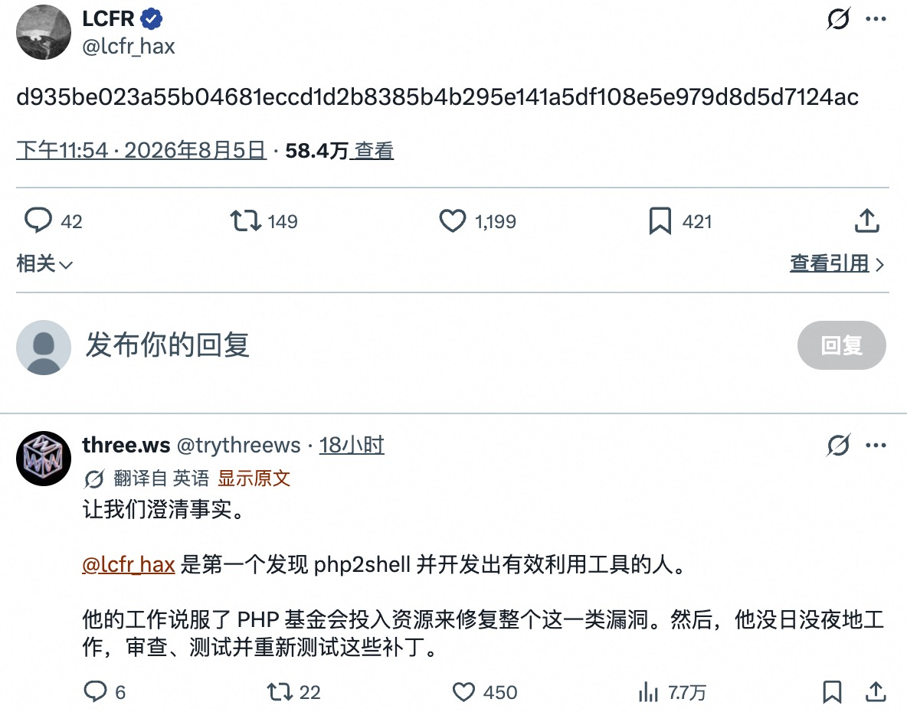

dig看看最后一张图 检索提供lcfr帖子密码串涵义的bg-info 

**解读**

最后一张图里 LCFR 在 2026 年 8 月 5 日发的那串 `d935...24ac` 更像不是“密码”，而是一个公开的哈希承诺：先把某份未公开材料的哈希发出来，之后再公开原文，就能证明自己当时已经持有那份内容；密码学里这类做法就是 hash-based commitment。([crypto.stanford.edu](https://crypto.stanford.edu/cs355/23sp/lec3.pdf)) 放回 PHP2Shell 的语境看，公开资料里 `lcfr-hax` 确实被列为漏洞报告者之一，且有安全圈整理直接把这条旧推文解释成“样本 payload 的哈希”，用来给“我更早就发现并做出了可用 exploit”做时间戳式佐证。([projectdiscovery.io](https://projectdiscovery.io/research/php2shell)) 所以它的涵义更接近“优先发现/先前持有 exploit 材料的证明值”，不是拿来登录的口令；不过我暂时没检到 LCFR 公开这串哈希对应的完整原文，所以不能仅凭这串值反推出具体 payload。([crypto.stanford.edu](https://crypto.stanford.edu/cs355/23sp/lec3.pdf))

### 问答 7

**问题**

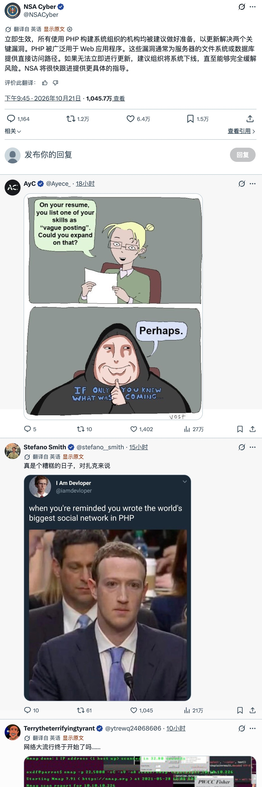

dig看看最后一张图 检索提供回帖出现zuck的bg-info

**解读**

最后一张图里 Stefano Smith 那条带 Zuck 的回帖，玩的是“Facebook 明明从 PHP 起家，现在 PHP 出大洞就会想到扎克”的梗。Facebook 工程团队 2010 年公开写过，公司前六年一直受益于 PHP 的快速开发，之后又为规模化陆续做了 HipHop for PHP、HHVM，并在 2014 年推出与 PHP 互操作的 Hack；Hack 官方现在仍说 Facebook 的 Web 代码库有数亿行 Hack，所以更准确的背景是 Meta 的服务端血统确实来自 PHP，但早已演化成 Hack/HHVM 体系，不是今天还在直接跑传统 PHP。图里那张 Zuck 苦脸照则是 2018 年数据隐私风波后的国会听证时期经典画面，这次被翻出来，是因为 2026 年 10 月 21 日公开的 PHP2Shell 属于核心 PHP 高危漏洞，CISA 和 NSA 都在催促尽快打补丁。 ([engineering.fb.com](https://engineering.fb.com/2010/02/02/web/hiphop-for-php-move-fast/))

### 问答 8

**问题**

dig看看https://github.com/openai/php2shell-checker/ 检索提供该工具如何接入agent以及工具检测限制的bg-info

**解读**

按仓库当前公开说明，`php2shell-checker` 的官方 agent 接入方式是把它当成两个 standalone Codex skills 来装：README 让你用 `skill-installer` 从仓库安装 `phpcheck-server` 和 `phpcheck-url`，而 OpenAI 的技能文档说明这类 skill 本身就是“`SKILL.md` + 可选脚本/资源”的工作流封装，不一定要先做成 MCP server；模型会先看 skill 的 name/description，在请求匹配或你显式调用时再加载完整指令，所以它本质上是技能式接入。([github.com](https://github.com/openai/php2shell-checker)) 检测限制也写得很直白：它只根据 `php -v` 或 HTTP `Server`/`X-Powered-By` 暴露的版本做被动判断，先发 HEAD、只在 405/501 时退回 GET，不跟重定向、不查响应体、也不会做 exploit probe；再加上发行版 backport 可能不改上游版本号、CLI PHP 也未必等于真正服务站点的 PHP-FPM/Apache 版本，所以 `OK` 只是基于内置 cutoff 的版本比较，不等于独立验证已打补丁，很多场景最多只能给出 `UNKNOWN`。([github.com](https://github.com/openai/php2shell-checker))

### 问答 9

**问题**

dig看看https://rpms.remirepo.net/

**解读**

我这边没直接跑本机 `dig`，但从公开信息看，`rpms.remirepo.net` 是 Remi Collet 长期维护的官方 RPM 仓库，官方配置页写明它自 2007 年起提供 Enterprise Linux 仓库，靠 `remi-release` 和 GPG key 分发包，而且自 2026 年 8 月 12 日起 EL7 及更早仓库已关闭。就这次 2026 年 10 月 21 日的 PHP2Shell 修复，仓库索引已经能看到 EL8/EL9 的 PHP 8.2.35、8.3.36、8.4.27 包，维护者也明确表示本轮更新面向 Fedora 43+ 与 RHEL 8+，不会再给 EL7 出补丁，所以如果你机器还卡在 EL7/老 PHP 分支上，别等这个 repo 自动救场，得尽快迁移或自行 backport。 ([blog.remirepo.net](https://blog.remirepo.net/pages/Config-en))

### 问答 10

**问题**

dig看看https://docs.gitlab.com/releases/patches/patch-release-gitlab-19-5-1-released/

**解读**

我看了 GitLab 官方这页，2026 年 10 月 21 日发布的 19.5.1、19.4.3、19.3.6、19.2.9、19.1.9、19.0.10 和 18.11.13 确实是一次 critical patch release，官方明确要求所有 self-managed 的 CE/EE 立即升级，GitLab.com 已经跑在修复版上，部分 GitLab Dedicated 内部版本也已提前带上补丁。 ([docs.gitlab.com](https://docs.gitlab.com/releases/patches/patch-release-gitlab-19-5-1-released/)) 这次最关键的条目是 CVE-2026-110264，官方公开摘要写得很直接：这是正则表达式编译器里的整数溢出，在特定条件下可让未认证攻击者通过特制正则在服务器上执行任意代码；另外 GitLab 还放了两条 threat detections 供自托管客户排查利用尝试。 ([docs.gitlab.com](https://docs.gitlab.com/releases/patches/patch-release-gitlab-19-5-1-released/)) 不过这篇补丁说明本身主要给的是修复版本和行动建议，并说明更细的安全 issue 会在补丁发布 90 天后公开，所以现在最稳妥的读法就是“这事是真的而且级别很高，先升级”，而不是只凭这页去外推出更完整的利用链或实际受害规模。 ([docs.gitlab.com](https://docs.gitlab.com/releases/patches/patch-release-gitlab-19-5-1-released/))

### 问答 11

**问题**

dig看看https://nodejs.org/en/blog/vulnerability/october-2026-security-releases/

**解读**

我看了 Node.js 官方在 2026 年 10 月 21 日发布的安全公告，你贴文里关于 Node.js 的核心点基本对：官方确认存在一个高危 Brotli 解码器越界写漏洞 CVE-2026-111497，影响 22.x、24.x、26.x，并且官方表述不是“可能”，而是直接写明可导致远程代码执行；同日对应的修复版本是 22.23.4、24.22.1 和 26.12.1。更严谨地说，这篇官方公告页面本身没有提到 AI 参与发现，也没有展开“内存泄露”的表述，所以若按原文复述，写成“Node.js 在 2026-10-21 修复了 Brotli 解码器越界写高危漏洞，可导致 RCE”会更贴近官方说法。 ([nodejs.org](https://nodejs.org/en/blog/vulnerability/october-2026-security-releases))

### 问答 12

**问题**

dig看看https://blog.railway.com/p/security-disclosure-wednesday-october-21st/

**解读**

我看了 Railway 在 2026 年 10 月 21 日的官方披露，这不是普通平台故障，而是一次明确涉及密钥/凭据暴露风险的安全事件：Railway 说存放客户环境变量的系统出现异常，未授权第三方可能访问了加密环境变量，而且其中一部分可能已经拿到解密后的内容，所以官方建议所有用户立即轮换 Railway 里的 API 密钥、数据库和私有镜像仓库凭据，并检查异常日志，调查期间还暂停了部署。 ([blog.railway.com](https://blog.railway.com/p/security-disclosure-wednesday-october-21st)) 到 2026 年 10 月 22 日，Railway 又连续发布了针对 OpenAI、GCP、GitHub/bucket 等凭据轮换和滥用排查的操作指南，甚至主动重置了部分 bucket 凭据和 GitHub token，这说明他们的应急重点就是“大规模密钥轮换 + 滥用排查”，不只是恢复构建。 ([blog.railway.com](https://blog.railway.com/p/security-disclosure-recommendation-redeploy-buckets-and-reconnect-github-after-the-credential-reset)) 值得注意的是，这篇官方披露里没有提到 PHP 或 PHP2Shell；Railway 只说它“相信”这是近期针对平台公司、意在攻向 AI 推理提供商的一串攻击的一部分，而且目前初步判断可能只影响部分用户，所以现阶段更稳妥的表述是：Railway 已确认存在密钥暴露风险，但尚未公开把它明确归因到 PHP2Shell，也还没给出完整受影响范围。 ([blog.railway.com](https://blog.railway.com/p/security-disclosure-wednesday-october-21st))

---

## 02. Flint 与自动化研究：本地代码模型、更小型团队与科研工作流

### 新闻背景

Flint 发布时就支持广泛的本地部署。Recursive 发布了一款采用 Apache-2.0 许可的代码 MoE 模型，总参数约 400 亿，激活参数 25 亿，上下文窗口为 26.2 万 token。LM Studio 表示其本地运行大约需要 24GB。Recursive 将其定位为前沿云端代理的设备端补充，而不是替代品。

在宣称成绩方面，Recursive 表示 Flint 在 Terminal-Bench 2.1 上达到 54.9%，在 SWE-bench Pro v2 上达到 89.7%，在 SWE-bench Verified 上达到 74.2%。不过这些仍然是发布方自报结果，并非独立复现。

性能方面，官方宣传其在短上下文下，MacBook Pro 上速度超过每秒 125 个 token，在 RTX Spark 上超过每秒 150 个 token。另有一位用户在使用 int4 MLX 的 M5 Max 上测得每秒 114 到 132 个输出 token。这可以作为速度的有用旁证，但并不是受控条件下的能力评估。

研究贡献方面，Recursive 表示其 Eureka Machine 参与了从构想到实现再到验证的全过程，贡献包括稀疏架构选择、低比特训练和内核优化。它声称在几乎不损失质量的情况下把模型体量缩减了 71%，并且从零开始开发耗时不到四个月。

可用性方面，首日集成同时覆盖本地框架和托管访问。vLLM 表示，在 10 万上下文长度、不开启投机解码、使用 NVFP4 的条件下，单张 GB200 可达到每秒 500 个 token；OpenRouter 则提供免费首发访问。

Mirendil 声称实现了单研究员的大规模预训练。Mirendil 表示，其首个基础模型由一名研究员在 3.5 个月内完成，算力成本低于 1000 万美元，其中包括研究实验和最终训练。它公开的不是精确配置，而是异常宽泛的参数范围：Base 为 1000 亿到 5000 亿，Large 为 5000 亿到 2 万亿，XL 为 2 万亿到 10 万亿。由于独立评测、后训练结果和 API 访问仍未公布，这是一项影响重大的效率宣称，但仍有待外部验证。

JOLT 同时训练教师模型和学生模型。Perplexity 与 NVIDIA 的后训练工作针对自蒸馏中的一个弱点：能力更强的教师模型可能会利用学生模型无法使用的捷径。JOLT 用结果奖励来训练教师，同时惩罚其与学生之间过大的偏离。作者称，在 MATH 基准上，它在训练 token 用量仅为 GRPO 约六分之一的情况下，达到了与 GRPO 相当的效果；加入学生结果奖励的 JOLT+ 则在五个评测基准上超过了 GRPO。

GPT-Rosalind 可以生成可检验的生物学假设。OpenAI 表示，数千个智能体在 32 分钟内把来自数百万个小鼠脑细胞的基因表达结果与文献关联起来。其中一个提出的机制把 DCTN1 的破坏与胆固醇运输受损联系起来；另一个则研究小脑神经元中 TSC1 与 TSC2 受损之间的差异。这些都只是供实验进一步验证的假设，不是已经证实的治疗方法，也不是经过验证的药物靶点。

### 问答 1

**问题**

dig看看https://recursive.com/updates/introducing-recursive-flint/

**解读**

我刚 dig 了官方发布页，Flint 更像是 Recursive 拿来证明“Eureka Machine 能参与造模型”的公开样品，而不只是又一个 coding 模型：它是面向本地 agentic coding 的 39.8B MoE，每个 token 约只激活 2.5B 参数，Apache 2.0 开源，官方说是小团队配合代理系统在不到四个月里从零做出来的。([recursive.com](https://recursive.com/updates/introducing-recursive-flint)) 我觉得最有意思的技术点不是分数本身，而是它连输出层都做了 4-bit 量化；另外博客写可到 512k context，但模型卡真正文档化的配置是 262,144 tokens，官方也建议实际使用尽量控制在 256k 左右。([recursive.com](https://recursive.com/updates/introducing-recursive-flint)) 所以结论很简单：这次发布最值得看的，是“自动化研究+本地推理工程”这条路线；至于它在 coding benchmark 上领先同量级 MoE 的说法，目前仍主要是 Recursive 自己的 release eval，先当厂商自报成绩看，等独立复现更稳。([recursive.com](https://recursive.com/updates/introducing-recursive-flint))

### 问答 2

**问题**

dig看看https://recursive.com/updates/introducing-recursive-flint/ 检索提供wrt lm_head的bg-info

**解读**

就 Flint 的 `lm_head` 来说，可以把它理解成把最后隐藏状态投到整个词表、生成每个 token 分数（logits）的语言模型输出头；而 Flint 这里不是常见的 tied 方案，NVIDIA 的 Flint 文档明确写它是 “untied FP32 head”，配置里 `tie_word_embeddings` 也为 `false`。([huggingface.co](https://huggingface.co/docs/transformers/model_doc/qwen2)) 这在 Flint 上尤其值得注意，因为官方兼容文档给出的 hidden size 是 2048、vocab size 是 150,144，粗算这个输出头本身就约有 3.07 亿权重；结合 Recursive 官方所说的“每个 token 只激活约 25 亿参数”，`lm_head` 在单步推理时占的权重读取比例已经不小。([docs.nvidia.com](https://docs.nvidia.com/nemo/automodel/model-coverage/large-language-models/recursivesi/flint)) 也正因如此，Recursive 在发布文里特地强调，它们的量化方案是“逆常规”地把 `lm_head` 也压到 4-bit，说明在 Flint 这种小 active-parameter 的 MoE 里，`lm_head` 已经是推理效率里的关键部件，不只是最后一层线性投影。([recursive.com](https://recursive.com/updates/introducing-recursive-flint))

### 问答 3

**问题**

dig看看https://lmstudio.ai/models/recursive-flint/

**解读**

我看了 LM Studio 的 Flint 页面，它把 Recursive Flint 定位成一个可本地运行的代码代理模型：39.8B 的 MoE，总体每个 token 约激活 2.5B 参数，支持推理、多轮工具调用和 262,144 token 上下文；LM Studio 目前标注最小门槛大约是 24GB RAM，提供 GGUF 版本，并提示实际内存占用、速度以及长上下文能不能真正塞下，都会随量化、硬件和运行时而变。页面上的高分也主要是官方自报，比如 SWE-bench Pro v2 89.7%、SWE-bench Verified 74.2%、Terminal-Bench 2.1 为 54.9%，所以更适合把它看成“很强的本地 coding/agent 候选”，而不是已经被你本机环境独立复现过的结论。 ([lmstudio.ai](https://lmstudio.ai/models/recursive-flint))

### 问答 4

**问题**

dig看看最后一张图 检索提供rtx spark电脑配置&价格的bg-info

**解读**

可补一句背景：图里说的 RTX Spark 不是传统独显，而是 NVIDIA 在 2026 年推出的本地 AI PC 平台；按官方桌面款 DGX Spark 来看，它用的是 GB10 Grace Blackwell，规格大致是 20 核 Grace CPU、6144 核 Blackwell RTX GPU、128GB 统一内存，AI 算力约 1 PFLOP FP4，本质上是一台面向本地推理和 agent 的小型 AI 主机。截至 2026 年 10 月 22 日，NVIDIA 美国官方商城里 128GB DGX Spark 标价 6,950 美元，欧盟价 7,490 欧元；如果说的是更偏消费级的 RTX Spark 笔电/PC，价格则由 OEM 决定，例如 Surface Laptop Ultra 起售价 2,599.99 美元，Dell XPS 16 Creator Edition 为 3,799.99 美元，另外 64GB 的 DGX Spark OEM 版定于 2026 年 10 月 23 日开卖，但 NVIDIA 官方博客没有给统一售价。 ([nvidianews.nvidia.com](https://nvidianews.nvidia.com/news))

### 问答 5

**问题**

dig看看https://github.com/Generated-Computers/Locals/ 检索提供repo名叫gen computer的bg-info

**解读**

我顺手 dig 了一下，公开背景目前不算多：GitHub 搜索结果显示 `Generated Computers` 现在公开能看到的项目基本就是 `Locals`；它把自己定位成一个面向 Apple Silicon Mac 的本地 agent 推理层/服务器，兼容 OpenAI 和 Ollama 接口，支持 OpenCode、OpenHands、Cline、Aider、Claude Code 等工具，PyPI 当前版本是 0.2.1。([github.com](https://github.com/Generated-Computers/)) 从文档和论文引用看，它更不像“又一个模型仓库”，而像是把结构化输出/工具调用的约束解码做成工程化运行时，再用批处理、prompt cache 和 GPU 上的约束检查去提升多智能体并发效率；官方基准里在部分 Mac 组合上相对 `mlx-lm` 可到约 2.5–3.2×，所以可以把它理解成“本地多 agent 加速层”。([pypi.org](https://pypi.org/project/locals/))

### 问答 6

**问题**

dig看看https://openrouter.ai/recursive/flint-v1.0:free/ 检索提供模型推理各项metric的bg-info

**解读**

截至 2026 年 10 月 22 日，我看了这个 OpenRouter 页面，`recursive/flint-v1.0:free` 是 2026 年 10 月 21 日上线的免费文本模型，262,144 token 上下文，而且目前只挂在 Recursive 这一个 provider 上，所以页面里的 latency、throughput、uptime 基本就是单端点的线上表现，不是多家后端混合路由的平均值。([openrouter.ai](https://openrouter.ai/recursive/flint-v1.0%3Afree)) 页面当前能直接看到的 serving metrics 主要是 P50 延迟 0.81 秒、P50 吞吐 110 tok/s、3 天 uptime 99.97%、availability 99.29%，外加 throughput、latency、E2E latency 的 P50/P75/P90/P95/P99，以及 tool call error rate、structured output error rate 和 cache hit rate；OpenRouter 对这些指标的背景说明里，throughput 就是生成速度（tokens/s），而 tool-call 成功率是从 Tool Call Error Rate 反推的，只要一次带 tools 的请求里出现 JSON 非法、函数名不在工具列表里，或参数不满足 schema，就会被记成错误请求。([openrouter.ai](https://openrouter.ai/recursive/flint-v1.0%3Afree)) 如果你还想看更细的 bg-info，官方 endpoints API 在登录后还能给出最近 30 分钟的 latency/throughput 分位数、按 workload 拆开的 perf 指标，以及 5 分钟、30 分钟、1 天 uptime；但如果你找的是“能力分数”而不是“推理运维指标”，那要看模型卡里的 54.9% Terminal-Bench 2.1、89.7% SWE-bench Pro v2 和 74.2% SWE-bench Verified。([openrouter.ai](https://openrouter.ai/docs/client-sdks/python/components/publicendpoint))

### 问答 7

**问题**

dig看看https://mirendil.com/news/pretraining-at-scale-without-a-pretraining-team/

**解读**

我看了，Mirendil 这篇博文真正发布的不是一个已被外部验证的 SOTA 成品，而是一个研发组织效率实验：官方称 Mirendil-Base 是由 1 名研究员配合 agents 在 3.5 个月、不到 1000 万美元算力下从零预训练出的 competitive coding model。([mirendil.com](https://mirendil.com/news/pretraining-at-scale-without-a-pretraining-team/)) 它公开展示的比较也主要是“预测自家保留仓库代码”的 base-model 口径，对手是 Kimi-K3、GLM-5.3、DeepSeek-V4-Pro-Base 等强 coding base model。([mirendil.com](https://mirendil.com/news/pretraining-at-scale-without-a-pretraining-team/)) 但目前 Large/XL 还在训练，独立评测、post-training benchmark 和 API 都还没放出来，所以现阶段更像 Mirendil 的自报里程碑，而不是已经被外部坐实的能力结论。([mirendil.com](https://mirendil.com/news/pretraining-at-scale-without-a-pretraining-team/)) 另外，“没有 pretraining team”也不等于“没有组织级资源”：Mirendil 自己说 founding team 有 20 名研究和工程人员，而且已在 Google Cloud 上用 TPU 与 NVIDIA 基础设施跑预训练/后训练，因此我会把这件事理解成“AI 把预训练团队压缩到极小规模”的强信号，而不是单人车库奇迹。([mirendil.com](https://mirendil.com/news/announcing-mirendil/))

### 问答 8

**问题**

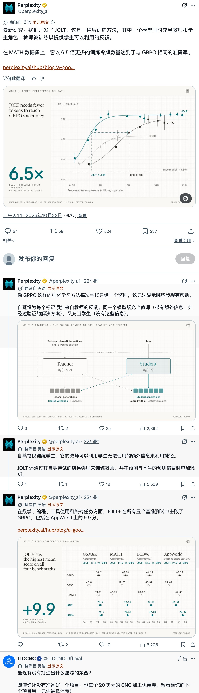

dig看看最后一张图 检索提供grpo是否主要为outcome-based reward强化学习算法的bg-info

**解读**

最后一张图的说法在常见训练配置下成立，但 **GRPO 并不限定只能使用 outcome-based reward（结果奖励）**。GRPO（组相对策略优化）的核心是对同一问题生成多条回答，用组内奖励的相对高低估计优势，而不依赖单独的价值网络。([arxiv.org](https://arxiv.org/html/2402.03300v3)) 在 DeepSeek-R1-Zero 等典型实践中，奖励主要来自最终答案正确性、代码测试结果等；结果监督版 GRPO 将整条回答的优势用于各 token 的更新，因此“逐 token 更新”不等于“逐步骤判分”，图中强调的正是这种监督稀疏性。([arxiv.org](https://arxiv.org/pdf/2501.12948)) 不过，DeepSeekMath 原论文 §4.1.3 已明确给出过程监督版 GRPO，所以更准确地说：**GRPO 是优化算法，outcome/process 是奖励设计**；JOLT 则利用教师逐 token 的蒸馏反馈提供更密集的学习信号。([arxiv.org](https://arxiv.org/html/2402.03300v3))

### 问答 9

**问题**

dig看看https://www.perplexity.ai/hub/blog/a-good-teacher-meets-the-student-where-they-are/

**解读**

这篇的亮点是**不只让学生模仿，也训练老师“教得动”**：JOLT让同一套权重扮演两个角色，老师看参考解、学生不看；老师通过结果奖励和向学生分布靠拢的KL约束学习，学生沿自己的生成轨迹获得逐token指导，避免老师依赖学生用不了的捷径。([perplexity.ai](https://www.perplexity.ai/en-GB/hub/blog/a-good-teacher-meets-the-student-where-they-are)) 作者报告的“6.5倍”指MATH同等准确率下，处理的训练token约为GRPO的1/6.5，不能直接理解为费用或耗时也降到相同比例。([arxiv.org](https://arxiv.org/pdf/2610.10447v1)) 更值得注意的是，你附图中基础JOLT在AppWorld仍落后GRPO，加入学生自身结果奖励的JOLT+才领先约9.9个百分点；这提示，至少在这类任务上，密集蒸馏与结果反馈更像互补关系，而非替代关系。([arxiv.org](https://arxiv.org/pdf/2610.10447v1))

### 问答 10

**问题**

dig看看https://www.perplexity.ai/hub/blog/a-good-teacher-meets-the-student-where-they-are/ 提供标题称之为老师学生meet where they are涵义的bg-info

**解读**

标题可理解为**“好老师，要从学生当前的水平教起”**。这里的 “meet the student where they are” 借用了教育中的理念：从学生已有的知识与能力出发，提供他们能理解、能用上的指导，类似“因材施教”，不是字面的“在哪里见面”。([tll.mit.edu](https://tll.mit.edu/teaching-resources/how-to-teach/help-students-retain-organize-and-integrate-knowledge/)) 文章中的老师和学生其实是同一模型的两种角色：老师能看到已验证的解答等额外信息，学生不能；因此老师可能借助答案走捷径，给出学生学不会的指导。([arxiv.org](https://arxiv.org/abs/2610.10447)) JOLT 的关键是不只训练学生模仿，也训练老师“怎么教”，通过结果奖励与约束师生预测差异的 KL 惩罚，让指导更贴合学生当前的能力。标题强调的就是：**会做题不等于会教，好的指导要让学生接得住。**([arxiv.org](https://arxiv.org/pdf/2610.10447v1))

### 问答 11

**问题**

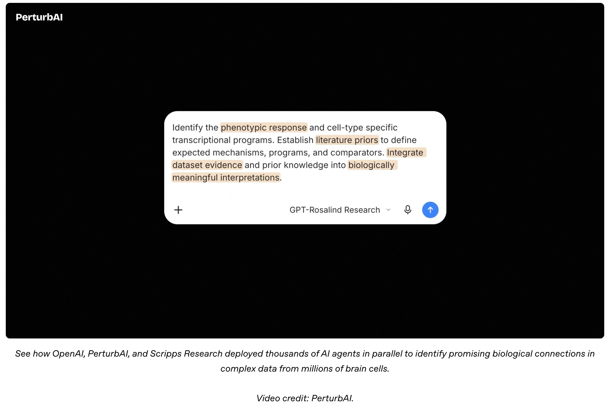

翻译最后一张图

**解读**

识别表型响应和细胞类型特异性的转录程序；基于文献建立先验知识，明确预期机制、转录程序和对照对象；整合数据集证据与已有知识，形成具有生物学意义的解释。看看 OpenAI、PerturbAI 和斯克里普斯研究所如何并行部署数千个 AI 智能体，从数百万脑细胞的复杂数据中发现有潜力的生物学关联。视频由 PerturbAI 提供。

### 问答 12

**问题**

dig看看https://openai.com/index/scaling-ai-research-for-complex-biological-data/ 检索提供rosalind模型在其中参与情况的bg-info

**解读**

GPT‑Rosalind是OpenAI于2026年4月推出的生命科学专用推理模型，侧重证据整合、假说生成和科研工具调用。([openai.com](https://openai.com/index/introducing-gpt-rosalind/)) 此次研究具体使用**GPT‑Rosalind‑5.5作为数千个并行智能体的推理核心**：各自分析基因扰动后的细胞响应、检索文献并提出机制解释，再汇总为“推理图谱”；32分钟指对既有实验数据的分析，而非完成实验。([biorxiv.org](https://www.biorxiv.org/content/10.64898/2026.10.15.759436.full.pdf)) 一个重要背景是，研究未向模型提供原研究手稿及结论，且模型知识截止时间早于原手稿发布，以降低直接复述已有答案的风险。([biorxiv.org](https://www.biorxiv.org/content/10.64898/2026.10.15.759436.full.pdf)) 因此，它的贡献主要是把大规模实验结果转化为可检验的生物学假说和后续研究线索，并不代表已经验证了疾病机制或疗法。([openai.com](https://openai.com/index/scaling-ai-research-for-complex-biological-data/))

---

## 03. 推理系统：DeepInfer 的经济性、原生 TPU 支持与电力约束下的算力扩展

### 新闻背景

**DeepInfer 公开生产环境中的调度技术**

DeepSeek 发布的框架结合了推测解码、动态调整预填充规模、根据请求数量和 KV 缓存长度均衡解码负载，以及让 CPU 调度与 GPU 执行重叠进行。其中一个尤其值得借鉴的思路是：根据预测的草稿接受率和实测硬件吞吐量，调整推测解码的验证长度，使各批次的负载更加均衡，避免由较慢的副本决定整体完成时间。（技术分析）

**缓存统计口径：** 一份部署报告摘要指出，每个预填充加速器的输入吞吐量在**计入缓存命中**时为每秒 150 万个 token；在缓存命中率为 96% 的情况下，排除缓存命中后则为每秒 6 万个 token。报告中的解码吞吐量为每个加速器每秒输出 1.4 万个 token。这些吞吐量指标的统计口径存在实质性差异。（报告摘要）

**经济性注意事项：** 同一份摘要提到，每个加速器每小时约 38 美元的数字是**收入，而非利润**。服务器、电力、冷却和人员成本均未从该数字中扣除。

**独立基准测试仍有争议**

SemiAnalysis 表示，InferenceX 没有纳入 DeepInfer，是因为其缺少关键的推理服务组件，而重建这些组件需要作出过多假设。SemiAnalysis 随后发布的盈利能力对比也遭到批评，原因包括混用不同代际的硬件、峰时与非峰时价格，以及收入与利润。

这些批评本身也是特定分析者的观点，并非已有定论的复现结果。实际比较经济性之前，必须统一硬件、工作负载、缓存假设、服务级别目标（SLO）和定价口径。（基准测试局限、对比分析批评）

**TorchTPU 开辟原生 PyTorch 路径**

Google 开源了 TorchTPU，让开发者能够通过熟悉的 PyTorch 工具进行训练和推理服务部署。据称，SGLang 的插件已用于 Meta 的生产环境推理，并支持多款当前的开放模型。

其定制 MegaKernel 宣称，在批大小为 1、输入 8K token、输出 1K token 的工作负载下，Muse Spark Open 的解码速度可达到每秒 770 个 token。vLLM-TorchTPU 则增加了前缀缓存、推测解码和分离式推理服务支持。（Google、SGLang、vLLM）

**GTC 强调部署速度与电力利用率**

NVIDIA 的 DSX POD 将 AI 基础设施封装成集装箱式模块。相关报道宣称，扩充算力容量所需的时间可以从数月缩短至数天。

更具体的结果是：Lambda 使用 DSX MaxLPS，演示了让 19 个 HGX B200 节点在原本供 16 个节点使用的电力预算内运行。

部署时间应被视为产品方的宣称；节点数量的演示结果应被视为概念验证，而不是已经在整个集群范围内实现的算力扩容。（DSX POD、Lambda 演示）

### 问答 1

**问题**

dig看看最后一张图 检索提供CB全称 以及 paged kv cache技术的bg-info

**解读**

最后一张图里的 **CB 全称是 Continuous Batching（连续批处理）**：每一步 token 生成都重新调度，完成的请求退出，新请求补入，不必等整批最慢的请求结束。([huggingface.co](https://huggingface.co/docs/transformers/continuous_batching)) **Paged KV Cache（分页键值缓存）**是显存管理技术：KV 缓存保存历史 token 的注意力 Key/Value，避免后续生成时重复计算；代表性方案是 2023 年提出的 vLLM/PagedAttention。([huggingface.co](https://huggingface.co/docs/transformers/cache_explanation)) 它借鉴操作系统分页，把缓存拆成块，通过块表将逻辑顺序映射到不必连续的显存位置，随序列增长按需分配，减少预留浪费和碎片，让同样显存容纳更多并发请求。简单说，CB 管“请求怎么排”，分页 KV 管“缓存怎么放”。([huggingface.co](https://huggingface.co/docs/text-generation-inference/conceptual/paged_attention))

### 问答 2

**问题**

dig看看https://github.com/deepseek-ai/deepseek-recipe/

**解读**

deepseek-recipe 不是训练“配方”，而是 DeepSeek 官方的**协议适配与模型编解码层**：MIT 许可、Rust 核心＋Python 绑定，把 Chat Completions、Responses、Messages 请求统一成 Conversation，再生成 V4/V4.1 的 prompt/token，并解析思考、工具调用和流式响应。([github.com](https://github.com/deepseek-ai/deepseek-recipe)) 我看它的价值主要是减少自托管时的提示词与工具协议偏差，而非推理加速；模型计算、工具执行仍需另接，JSON Schema/regex 的强制约束也依赖后端。([github.com](https://github.com/deepseek-ai/deepseek-recipe/blob/main/README.md)) 一个容易忽略的部署坑是：参考服务器使用 mock 推理、没有鉴权，图片 URL 默认不拦截内网地址，不能直接当生产服务暴露公网。([github.com](https://github.com/deepseek-ai/deepseek-recipe/blob/main/server-rs/README.md))

### 问答 3

**问题**

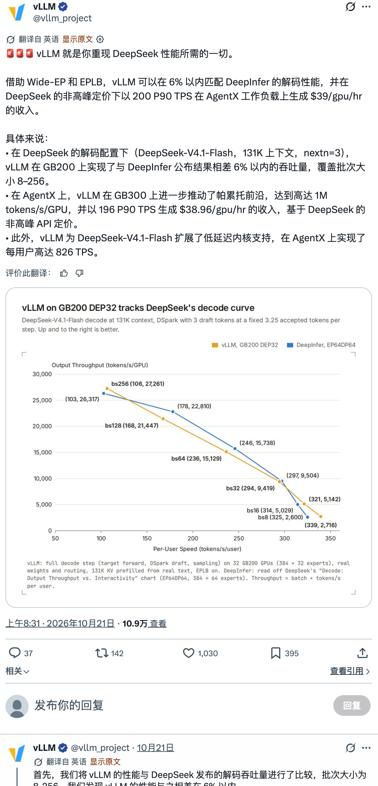

dig看看最后一张图帖子配图

**解读**

配图里“差距6%以内”按标注数字确实成立：batch 128时，vLLM是21,447、DeepInfer是22,810 tokens/s/GPU，相差约5.98%。但关键在脚注：vLLM是32张GB200的实测，DeepInfer是从64卡官方曲线读数，两者固定采用每步接受3.25个token的口径，而且只比较解码。**纵轴已经按GPU归一化，所以不是“32卡顶64卡”，而是特定条件下单卡解码效率接近**；完整服务还取决于预填充、缓存、通信和调度，不能据此认定整体成本也相当。([github.com](https://github.com/deepseek-ai/DeepInfer/blob/main/doc/inference_deployment_qa.md))

### 问答 4

**问题**

dig看看https://cloud.google.com/blog/topics/ai-infrastructure/torchtpu-is-now-open-source-run-native-pytorch-on-tpus/

**解读**

TorchTPU的关键不是“TPU首次能跑PyTorch”，而是让它成为原生PyTorch后端：Google与Meta联合开发，支持eager调试、`torch.compile`和原生分布式接口，底层依然使用XLA编译器。([pytorch.org](https://pytorch.org/blog/introducing-torchtpu/)) Transformers v5可通过`device_map="tpu"`加载模型，vLLM、SGLang等也已接入，减少了迁移时重写模型和工具链的负担。([cloud.google.com](https://cloud.google.com/blog/topics/ai-infrastructure/torchtpu-is-now-open-source-run-native-pytorch-on-tpus)) 我的判断是，这次开源主要降低了PyTorch用户选择TPU的工程门槛，并不证明TPU全面胜过GPU；官方也明确，“改设备就能跑”不等于最佳性能，仍需针对张量形状、分片策略和算子调优。([pytorch.org](https://pytorch.org/blog/introducing-torchtpu/))

### 问答 5

**问题**

dig看看https://www.lmsys.org/blog/2026-10-20-sglang-torchtpu/ 检索提供sglang这个推理stack在其中角色的bg-info

**解读**

SGLang 在这套栈中是**模型推理与服务层**，负责请求调度、批处理、RadixAttention 前缀缓存和 OpenAI 兼容 API，把模型组织成可并发调用的服务。([github.com](https://github.com/sgl-project/sglang/blob/main/docs/cookbook/autoregressive/Meta/MuseSparkOpen.mdx)) 2026 年 10 月 20 日发布的 SGLang-TorchTPU 由 RadixArk、Google 和 Meta 共建：保留 SGLang 原有调度器、模型实现与 API，通过插件补齐 TPU 专用的注意力/MoE 算子、KV 缓存池和执行器，再由底层 TorchTPU 经 `torch.compile`／XLA 执行计算。([lmsys.org](https://www.lmsys.org/blog/2026-10-20-sglang-torchtpu)) 关键并非“首次支持 TPU”——此前已有 JAX 路线——而是让开发者继续用熟悉的 PyTorch 代码开发、调试和部署，同时把缓存复用、推测解码及 prefill/decode 分离等生产能力带到 TPU，降低迁移成本。([developers.googleblog.com](https://developers.googleblog.com/announcing-new-vllm-and-sglang-inference-engines-on-tpu/))

### 问答 6

**问题**

dig看看https://nvidianews.nvidia.com/news/nvidia-introduces-dsx-pod-ai-factories-to-accelerate-europes-infrastructure-deployment/ 检索提供模块化构件&why强调欧洲的bg-info

**解读**

DSX POD 的“模块化构件”是可拼接扩容的预制集装箱单元：伙伴按英伟达参考设计，把 Vera Rubin 算力、网络、存储、供电、液冷和布线在工厂内集成、测试，再运至现场连接成 AI 工厂，而不是仅把 GPU 装进箱子。([developer.nvidia.com](https://developer.nvidia.com/blog/achieve-productive-ai-capacity-faster-and-more-predictably-with-nvidia-dsx-pod/)) 官方宣称部署从六个月缩至最快14天，前提是现场电力、冷却等配套已经准备好，并非从审批到建成只需两周。([nvidianews.nvidia.com](https://nvidianews.nvidia.com/news/nvidia-introduces-dsx-pod-ai-factories-to-accelerate-europes-infrastructure-deployment)) **强调欧洲，可理解为发布场景与市场需求相结合**：它在柏林 GTC 发布，而欧盟正推动本土算力与数字主权，目标是未来5—7年将数据中心容量至少增至三倍，却面临审批缓慢、能源供给及电网压力；模块化方案正好回应“如何更快把投资变成可用算力”的需求。([nvidianews.nvidia.com](https://nvidianews.nvidia.com/news/nvidia-introduces-dsx-pod-ai-factories-to-accelerate-europes-infrastructure-deployment)) 但它并非欧洲专供，伙伴计划于2027年初开始全球交付。([nvidianews.nvidia.com](https://nvidianews.nvidia.com/news/nvidia-introduces-dsx-pod-ai-factories-to-accelerate-europes-infrastructure-deployment))

---

## 04. 评测可信度与智能体工程：衡量运行框架，而不只是模型

### 新闻背景

**医学推理揭示完整性与准确性之间的权衡**

Artificial Analysis 修订了 MLCR-AA 的提示词、参考答案和由三个模型组成的评审团。Sonnet 5.5 与 GPT-6 Astra 以 41.7% 的成绩并列；在同时满足完整性与准确性的要求下，没有任何模型超过 42%。Claude 在完整性方面领先，OpenAI 在基于病历的准确性方面领先。修订后的分数不能与采用旧方法得出的分数直接比较。（结果、评测方法）

**回答长度这一混杂因素：**一项跨基准分析发现，Claude 的回答长度约为 OpenAI 的 4—6 倍；每增加一项陈述，就多一次与病历内容矛盾的可能。因此，原始评分标准下的得分、完整性，以及经过长度校正的质量指标，会产生不同的排名。（对比分析）

**SWE-bench Multimodal 面临消融检验的挑战**

一项独立调查认为，v2 实际上并不需要图像信息；另一位研究者则强调，去掉图像后运行基准，是必不可少的合理性检查。这是对该基准究竟在衡量什么的实质性质疑，但并不能证明其中的编程任务本身没有价值。（调查、消融实验讨论）

**演化后的运行框架与交互接口，能提升固定执行模型的表现**

两篇论文进一步支持了这样一种思路：优化智能体周围的运行环境，而不只是改进模型。

**OO-Harness：**通过专用子类、从执行过程中提炼的设计经验，以及路由机制，在使用同一个 Gemini 3.5 Flash 执行模型的情况下，AutomationBench 成绩从 61.6% 提升至 77.4%；Workspace-Bench 成绩从 25.5% 提升至 39.5%。（论文摘要）

**Agent S4：**一个元智能体根据不带成功标签的执行轨迹构建工具。论文报告，开放的 27B 模型在 OSWorld V2 上达到 21.3%，是同一模型使用人工构建接口时成绩的 3.8 倍；ScienceBoard 成绩则从 41.4% 提升至 58.6%。这些是论文报告的系统级结果，并非仅针对模型本身的比较。（摘要）

**SuperMimic 致力于降低人形机器人训练成本**

研究者报告，使用一块 GPU、耗时三小时，就完成了涵盖 129,514 个动作的训练；相比之下，文中引用的最先进方案需要 128 块 GPU 运行七天。

其机制将一个通过学习得到的可微世界模型代理，与时间反向传播相结合。所声称的超过 1,000 倍的 GPU 小时用量缩减，仅针对这一动作控制训练配置，并不代表机器人学习整体都能获得同样的提升。（结果、机制）

### 问答 1

**问题**

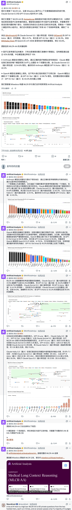

dig看看最后一张图 检索提供完整vs.准确性tradeoff的bg-info 举一个具象例子

**解读**

最后一张图的关键是**“没说错”不等于“答完整”**：MLCR-AA让模型综合长而零散的病历，“准确性”检查回答中有没有与病历矛盾的陈述，“完整性”检查所需的结论、证据和推理是否齐全；遗漏不算准确性错误，但会影响完整性，最终通过必须两者同时满足。([wisedocs.ai](https://www.wisedocs.ai/blogs/mlcr-v1-1-calibrating-llm-judges-for-long-context-medical-reasoning)) 举个简化的假设例子：病历写着“4月1日腕部扭伤，X光未见骨折，戴护具后疼痛缓解”，问题要求总结伤情、检查和治疗效果。只答“腕部扭伤”，准确却不完整；三项都交代清楚，却额外把检查日期写成“5月1日”，则覆盖了要求，但准确性不通过。这里的取舍是：少说可能减少错误，也可能漏掉关键点；多说增加覆盖，也增加引入错误的机会——并非完整与准确必然对立。

### 问答 2

**问题**

dig看看https://artificialanalysis.ai/evaluations/healthbench-professional/ 检索提供typical模型表现diff的bg-info

**解读**

HealthBench Professional 提供的关键背景是：**模型差距不仅取决于医学能力，也受回答篇幅和评分口径影响**。它包含525段医生咨询、写作与研究对话，按医生制定的细则评分，并以2,000字符为基准调整长度。([artificialanalysis.ai](https://artificialanalysis.ai/evaluations/healthbench-professional)) AA在2026年10月19日的分析中指出，Claude Opus 5.5原始分以71.4%居首，但平均回答约5,900字符，长度校正后降至59.9%；GPT-6 Sol平均约1,600字符，反而获得加分。([artificialanalysis.ai](https://artificialanalysis.ai/articles/healthbench-professional-health-conversations)) 校正后的前三是GPT-6 Astra 66.0%、GPT-6.1 Sol 65.1%、Sonnet 5.5 63.0%（均为max配置，Claude含回退）。因此，这组结果体现了详细覆盖与简洁性的权衡，不能把榜单百分比直接理解为临床诊断正确率。([artificialanalysis.ai](https://artificialanalysis.ai/evaluations/healthbench-professional))

### 问答 3

**问题**

dig看看https://sankalp.bearblog.dev/swe_multimodal/ 检索提供blog在审视bench什么问题维度的bg-info 举一个具象例子

**解读**

这篇博客审视的是 benchmark 的**“构念效度”：它声称测多模态能力，得分是否真的依赖看图？**背景是 SWE-bench Multimodal 把软件修复评测扩展到带截图等视觉信息的 JavaScript 项目，但“题目包含图片”不等于“解题必须理解图片”。([arxiv.org](https://arxiv.org/abs/2410.03859)) 具象例子是作者对 GPT-6 Luna（xhigh）做消融：分别提供原图、仅提供 OCR 文本、完全不给图，成绩却相近；他进一步认为，许多任务的关键线索已在文字描述中，或能从代码推导出来。([sankalp.bearblog.dev](https://sankalp.bearblog.dev/swe_multimodal/)) 因而，这项实验质疑的是“能否把修复成功归因于视觉理解”，而非代码任务本身有没有价值；结论也应限于作者测试的配置。

### 问答 4

**问题**

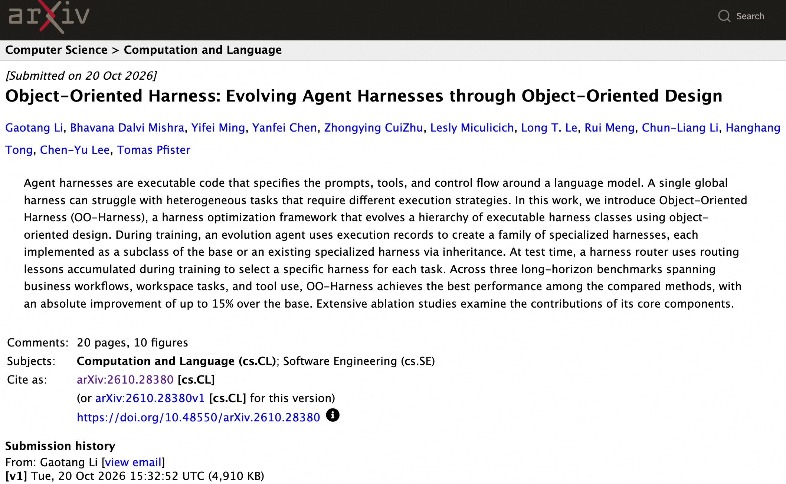

翻译最后一张图论文标题和摘要

**解读**

**标题：面向对象的执行框架：通过面向对象设计演化智能体执行框架**

**摘要：**

智能体执行框架（agent harness）是一套可执行代码，用于规定语言模型所使用的提示词、工具以及控制流程。对于需要不同执行策略的异构任务，单一的全局执行框架可能难以有效应对。本文提出面向对象执行框架（Object-Oriented Harness，简称 OO-Harness），这是一种执行框架优化方法，利用面向对象设计，演化出具有层级结构的可执行框架类。

在训练阶段，一个演化智能体利用执行记录创建一组专用框架，每个框架都通过继承基础框架或已有的专用框架，以子类形式实现。在测试阶段，框架路由器利用训练过程中积累的路由经验，为每项任务选择合适的专用框架。

在涵盖业务工作流、工作空间任务和工具使用的三个长程任务基准测试中，OO-Harness 在所有参与比较的方法中取得了最佳表现，相较于基础框架，性能的绝对提升最高达 15 个百分点。本文还通过广泛的消融实验，考察了各核心组件对性能提升的贡献。

### 问答 5

**问题**

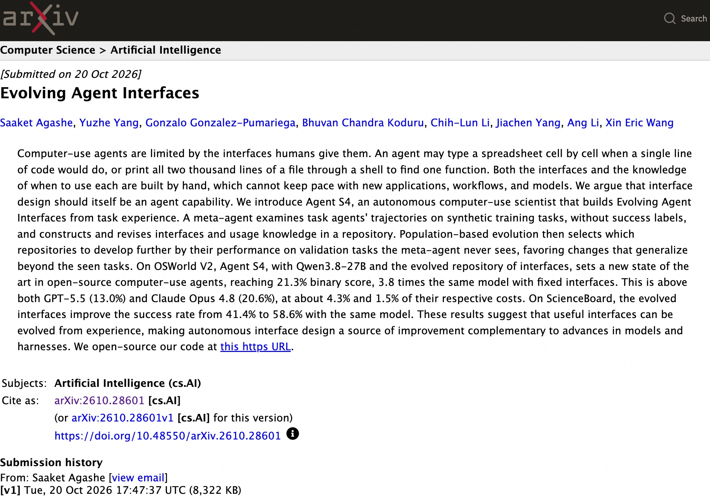

翻译最后一张图论文标题和摘要

**解读**

**标题：智能体接口的演化（Evolving Agent Interfaces）**

**摘要**

计算机操作智能体的能力受到人类为其提供的接口限制。智能体可能逐个单元格填写电子表格，而实际上只需一行代码就能完成；也可能通过命令行输出某个文件的全部两千行内容，只为寻找其中一个函数。无论是接口本身，还是何时使用各个接口的知识，目前都由人工构建，难以跟上新应用、新工作流程和新模型的发展。我们认为，接口设计本身也应成为智能体的一项能力。

我们提出 Agent S4，一个能够自主研究计算机操作的智能体，它可以根据任务经验构建持续演化的智能体接口。一个元智能体会分析任务智能体在合成训练任务上的执行轨迹，在不获得成功标签的情况下，在代码仓库中构建并修订接口及其使用知识。随后，基于种群的演化过程会根据各个仓库在验证任务上的表现，选择值得进一步发展的仓库。这些验证任务对元智能体始终不可见，因此，该过程会优先保留能够泛化到已见任务之外的改进。

在 OSWorld V2 上，Agent S4 结合 Qwen3.8-27B 和演化后的接口仓库，取得了开源计算机操作智能体的新最佳成绩，二元评分达到 21.3%，是同一模型使用固定接口时的 3.8 倍。这一成绩高于 GPT-5.5 的 13.0% 和 Claude Opus 4.8 的 20.6%，而成本分别仅为两者的约 4.3% 和 1.5%。在 ScienceBoard 上，使用同一模型时，演化后的接口将任务成功率从 41.4% 提升至 58.6%。

这些结果表明，实用的接口可以从经验中演化出来，使自主接口设计成为一种新的改进来源，与模型本身及智能体运行框架的进步形成互补。我们已开源代码，链接见原文。

### 问答 6

**问题**

dig看看https://supermimic.github.io/ 检索提供可微world model在其中角色是为加速rollout生成吗的bg-info 举一个具象例子

**解读**

**不只是加速 rollout，更关键是让 rollout 可以反向传播。**作者论文说明，SuperMimic 用物理仿真器采集的状态转移训练一个可微动力学模型，在其中快速预测短段运动轨迹，再通过时间反向传播（BPTT），把动作跟踪回报的梯度传回控制策略；因此收益既来自“模拟得更快”，也来自“每次模拟能提供更直接的优化方向”。([arxiv.org](https://arxiv.org/abs/2610.28480)) 举个示意例子：机器人模仿抬腿，策略发出腿部控制动作，世界模型预测随后几步的身体姿态；如果预测身体倾斜过大、偏离参考动作，误差就能沿“预测姿态→控制动作→策略参数”反传，指导策略调整，而不只是反复试不同动作、比较哪个得分高。这里的世界模型是**可求导的机器人动力学替身**，不是视频生成器；物理仿真器仍负责提供训练它的数据。([arxiv.org](https://arxiv.org/pdf/2610.28480))

---

## 05. 智能体产品、检索模型与 API 分发

### 新闻背景

**Claude Duet 进入研究预览阶段：** Anthropic 为这款由 Opus 5.5 驱动的主动式助手开放了候补名单。据报道，首批使用资格面向美国的 Pro 和 Max 用户。使用示例包括监控 Slack、准备问题，以及根据用户请求进行购买。Stripe 介绍了通过 Link 钱包购物，以及基于 MCP 开具发票、处理退款和分析收入的功能。产品仍处于预览阶段，所提供的帖子未披露单独定价。（相关来源：Anthropic 高管、使用资格、支付集成）

**检索模型新品着眼于准确性与上下文成本：** Cohere 推出 Rerank 5，提供 Pro 和 Fast 两个版本。其可选启用的 Context Focus（上下文聚焦）功能返回经过评分的文本段落，而不是整份文档；官方宣称，在保持准确性的同时，最多可减少 41% 的 token 消耗。另外，ParseBench 报告称，NVIDIA 参数量不足 10 亿的 Nemotron 3.5 Parse 在其文档理解基准测试中位居第一。（相关来源：Cohere 功能介绍、可用性、ParseBench）

**Kling 4.0 已开放 API 接入：** fal 最初宣布可通过用户界面和智能体使用该模型，API 支持即将推出；随后，Kling 宣布其官方 API 正式上线。官方宣称的改进主要集中在复杂运动的稳定性、参考内容的一致性，以及电影级画面控制。后续公告已取代此前“API 即将推出”的状态。（相关来源：fal 发布公告、API 上线公告）

**企业模型接入渠道扩大，Claude 同时更新 API 版本：** OpenAI 宣布，其前沿模型与 Codex 工作流将接入 Google Cloud Model Garden。与此同时，Anthropic 的 API 版本 `2026-10-21` 从 Messages 接口中移除了 `temperature`、`top_p` 和 `top_k` 参数。新发布的 SDK 大版本默认使用这一 API 版本，但 `2023-06-01` 版本仍受支持。团队升级 SDK 时，应明确检查版本迁移带来的行为变化。（相关来源：Google Cloud 分发渠道、版本变更、SDK 默认设置）

### 问答 1

**问题**

dig看看https://claude.com/resources/articles/claude-duet/ 举一个使用场景的具象例子

**解读**

比如你经营一家设计工作室，授权 Claude Duet 连接 Stripe 和邮箱后，发一句：“查一下哪些客户还没付款，帮我写好催款邮件。”你关掉应用去开会，它可以继续在后台检查账单、整理未付款客户并起草邮件，发送前再请你审核确认。它不只是告诉你“怎么催款”，而是把查账、拟邮件这些准备工作做完，把最终决定留给你。([support.claude.com](https://support.claude.com/zh-CN/articles/17631495-%E5%BC%80%E5%A7%8B%E4%BD%BF%E7%94%A8-claude-duet))

### 问答 2

**问题**

dig看看https://cohere.com/blog/rerank-5/ 举一个使用场景的具象例子

**解读**

比如做一个公司差旅报销助手：员工问“东京出差，每晚1000元的酒店能报吗？”现有搜索先召回几十份制度，**Rerank 5 把住宿限额和超标审批相关文件排到前面**；开启 Context Focus 后，系统只将其中的关键条款交给大模型，不必塞入整本员工手册。假设制度规定“上限800元，超标需主管审批”，助手便据此解释审批要求并引用原文。它的价值不是替人审批，而是帮回答模型找到更相关的依据，同时减少无关上下文和 token 开销。([cohere.com](https://cohere.com/rerank))

### 问答 3

**问题**

dig看看https://openai.com/zh-Hans-CN/index/openai-models-google-cloud/ 举一个使用场景的具象例子

**解读**

比如，设想一家使用 Google Cloud 的电商公司，发现“同一张优惠券能重复使用”：开发者接入 Codex，让它检查授权代码库、修正核销逻辑、补上并运行回归测试，最后由工程师审核合并。([help.openai.com](https://help.openai.com/en/articles/20001545-using-codex-cloud)) 这次合作的实际价值，是把这类 AI 开发能力接进企业已有的云环境，结合 Google Cloud 的权限管理和数据治理，而不只是另开一个聊天窗口。目前仍是邀请制的开发与内部测试预览，尚未全面开放生产使用。([openai.com](https://openai.com/zh-Hans-CN/index/openai-models-google-cloud/))

### 问答 4

**问题**

dig看看https://platform.claude.com/docs/en/api/migration-2026-10-21/ 举一个待迁移api开发者需要做什么的具象例子

**解读**

比如，你的客服后端直接调用 `/v1/messages`，用 Sonnet 4.6 配合 `temperature: 0.2` 降低回答随机性。迁移时不能只把请求头改成 `anthropic-version: 2026-10-21`，还要从请求体和公共封装中删除 `temperature`、`top_p`、`top_k`，即使传默认值也会报 HTTP 400。随后需要回归测试回答稳定性：新版默认温度为 1.0，没有替代的低温设置；如果业务依赖原来的低温效果，可以暂时让这些请求继续使用 `2023-06-01`。([platform.claude.com](https://platform.claude.com/docs/zh-CN/api/migration-2026-10-21))

### 问答 5

**问题**

dig看看https://platform.claude.com/docs/en/api/migration-2026-10-21/ 检索提供删除温度等infer采样参数的bg-info 举一个为什么要这么做的具象例子

**解读**

这次是**取消客户端采样旋钮，不是停止采样**：`2026-10-21` 下传入 `temperature`、`top_p`、`top_k` 都会报400，省略后仍按默认值采样，温度为1.0；迁移页并未解释底层设计动机。([platform.claude.com](https://platform.claude.com/docs/ja/api/migration-2026-10-21)) 一个有依据的技术解释是：**低温不等于推理更准确**——Google 官方明确警告，调低 Gemini 3 的温度可能导致循环或复杂任务表现退化。([ai.google.dev](https://ai.google.dev/gemini-api/docs/generate-content/gemini-3)) 举个解释性例子：让模型排查并发 bug，为求“稳定”设 `temperature=0`，可能反而反复沿同一种错误假设分析；更合理的控制方式是保留默认采样，提示它“检查不同线程交错，逐一验证假设”，用 `effort` 调推理深度，而不是把温度当准确率旋钮。这能说明移除参数的技术合理性，但不是 Anthropic 已公开确认的原因。([platform.claude.com](https://platform.claude.com/docs/en/build-with-claude/working-with-messages))

---

## 06. 行业与治理：研究人员的言论与公共利益监督

### 新闻背景

**不贬损条款受到审视：** 一些援引 BBC 报道的帖子声称，谷歌的雇佣合同无限期限制员工公开批评公司，抑制了有关 AI 安全与军事用途的讨论。前员工的叙述和研究人员的评论指出，这造成了“寒蝉效应”。这些是相关来源提出的合同与职场层面的说法；所提供的材料中没有公司回应，也没有法律认定。（报道摘录、研究人员陈述）

**Anthropic 更新公共利益治理：** Anthropic 发布了年度《公共利益报告》，并任命实验物理学家、哈佛大学前科学事务院长 Christopher Stubbs 加入其长期利益信托（Long-Term Benefit Trust）。这是治理方面的新进展，与公司的模型评测和产品发布属于不同事项。（报告、信托成员任命）

### 问答 1

**问题**

dig看看https://www.bbc.com/news/articles/cmreyvepnv0po/ 检索提供报道的bg-info

**解读**

这篇报道的背景是Google军事AI路线的转向：2018年承诺不开发武器或违反国际规范的监控AI，2025年2月4日删除了这些明确限制。([blog.google](https://blog.google/innovation-and-ai/products/ai-principles/)) 2026年4月的五角大楼协议据报道允许“任何合法政府用途”；虽然写有人类监督要求，却未赋予Google否决军方合法行动的权利，争议就在于监督能否真正落实。([money.usnews.com](https://money.usnews.com/investing/news/articles/2026-04-28/google-signs-classified-ai-deal-with-pentagon-the-information-reports)) 原本研究电网优化的DeepMind工程师Sofia Liguori因此抗议离职，其个人声明确认最后工作日为10月20日——她反对的是现实中的军事合作，而非遥远的“AI末日”。([theintercept.com](https://theintercept.com/2026/10/21/google-deepmind-resign-ai-military-gaza/)) 另外，你贴的摘要需补正：“终身禁评”是员工指称；BBC实际上已刊登Google回应，称设有举报渠道和反报复政策，并非完全没有公司回应。([tech.slashdot.org](https://tech.slashdot.org/story/26/10/22/0043216/google-staff-resign-in-backlash-over-its-ai-contracts-with-military))

### 问答 2

**问题**

dig看看https://www-cdn.anthropic.com/a9ceec76a54d28d27affffcdab6faf7c142cd587.pdf 检索提供未被广泛公众报道but anthropic已经/即将开展event/direction的bg-info

**解读**

顺着报告的科研线索，较少进入大众视野、却已落地的方向，是 **Anthropic 自建生命科学实验室，把模型训练、计算发现和湿实验验证放进同一团队**：团队于2026年春成立，正在用 Claude 挖掘未知蛋白家族、生成假说并开展实验；报告提到的新酶系统就是早期成果，但其功能仍未确定。([anthropic.com](https://www.anthropic.com/news/claude-discovers-novel-enzyme-system)) 更具体的近期动向是它与 Adaptyv 联合开展的蛋白设计竞赛，投入逾100万美元 Claude 额度及逾100万美元实验验证支持，计划测试5000余个设计并公开结果；按当前官方赛程，第五轮靶点将在 **2026年10月26日公布，11月8日截止提交**。这是一条值得跟踪的“AI发现—实验检验”布局，不等于已有新药或疗法获得验证。([proteinbase.com](https://proteinbase.com/competitions/anthropic-adaptyv-2026))

---

## 07. DeepSeek 新动态：DeepInfer（活跃度：441）

### 新闻背景

这张图片是 DeepSeek 在 X 上发布公告的截图，宣布其内部使用的大规模推理框架 **DeepInfer 现已完全开源**，并附有图片、GitHub 仓库和 X 帖文链接。DeepSeek 将 DeepInfer 描述为支撑 **DeepSeek-V4.1-Flash** 生产服务的推理技术栈，针对高吞吐量、低延迟服务进行了优化，以降低计算成本和能耗。链接中的一篇知乎文章声称，单个集群每天可处理 **155 万亿个 token**，按非高峰时段的定价计算，每张卡每小时可产生约 **38 美元收入**。评论者认为，与 Anthropic、OpenAI 或 Meta 相比，这种开源力度非常激进，有人表示这些公司“绝不会这么做”。也有用户仍不清楚这个框架的实际用途，直接问：“它到底是干什么的？”

链接中的知乎文章声称，DeepInfer 能为 **DeepSeek V4.1 Flash** 提供高吞吐量、低延迟推理，单集群吞吐量达到每天 **155 万亿个 token**，按非高峰时段定价，每张卡每小时收入为 **38 美元**。文章地址：https://zhuanlan.zhihu.com/p/2095560295930508953。评论者强调，相比 OpenAI、Anthropic 或 Meta 等公司，这是一次力度异乎寻常的公开技术披露。

一个技术层面的疑问是：DeepInfer 究竟是真正的**通用推理框架**，还是主要针对 **DeepSeek 自身的模型架构**进行了优化？一位评论者指出，与旗舰模型绑定、看起来很亮眼的框架发布，往往包含架构专属优化，而这些优化未必能顺利迁移到其他大语言模型。

帖子讨论中提到的一项性能数据约为 **256 token/秒 × 100 名用户**，评论者认为这代表极高的并发服务吞吐量。这意味着，DeepInfer 可能主要面向**生产环境中的大规模多用户推理**，而不只是追求单请求延迟基准测试的表现。

### 问答 1

**问题**

dig看看最后一张图 假设单cluster有4w张gpu 那么一个月该集群总revenue是多少

**解读**

**约 10.94 亿美元/月，按一个月 30 天计算。**

我追到了 DeepSeek 官方部署 Q&A，确实给出了 **38 美元/GPU·小时的营收**，注明按低峰时段定价核算。([github.com](https://github.com/deepseek-ai/DeepInfer/blob/main/doc/inference_deployment_qa.md))

假设单集群有 **4 万张 GPU**，且整月持续维持这个单卡营收水平：

$$
40{,}000 \times 38 \times 24 \times 30
= 1{,}094{,}400{,}000\ \text{美元}
$$

也就是每天 **3,648 万美元**，每月 **10.944 亿美元**；如果按 31 天，则是 **11.3088 亿美元**。

注意，这是按报告数字做的**条件外推，不是已确认的实际月营收，更不是利润**。关键前提是付费需求足以让整个集群持续达到这个收入水平；硬件、电力、存储及运维成本还没有扣除。

---

## 08. EAGLE-4 发布：比 DFlash2 和 DSpark 更快（活跃度：306）

### 新闻背景

**EAGLE-4 是一套源代码可获取的推测解码技术栈**，采用针对硬件和工作负载校准的草稿树，并通过 `eagle-harness` 提供与 SGLang、vLLM 和 TokenSpeed 的集成方式。目前披露的支持情况和基准测试主要围绕 **Qwen3.8-27B** 展开。

帖子列出了相对于常规解码的加速倍数：**MTP 为 2.22 倍，DSpark 为 2.57 倍，DFlash 2 为 2.80 倍，EAGLE-4 为 3.59 倍**。代码仓库则报告，在 **4 张 NVIDIA B300** 上进行 SPEED-Bench 测试、并发请求数为 1 时，SGLang、vLLM 和 TokenSpeed 分别获得 **3.42 倍、2.83 倍和 3.09 倍**的加速。据称，并发数提高后，加速收益会缩小。（[EAGLE-4 仓库](https://github.com/eagle-hq/EAGLE-4)）

评论者还提到了 **Nemotron Bolt 使用的 LiLiCorr**，将其视为另一种具有竞争力的推测解码方案，其论文提供了更细致的基准测试报告。（[论文](https://arxiv.org/pdf/2608.20530)）

评论者质疑，与 DSpark、DFlash 的对比是否具有代表性，因为汇总平均值可能掩盖不同工作负载下的性能差异。例如，**MTP 在代码、JSON 等结构化输出任务上可能表现更好**。他们希望看到按工作负载类型分别统计的结果。另一个问题是部署实用性：据称，**EAGLE-4 的草稿模型比 DFlash2 大约多占 3GB**，因此对于显存受限的部署环境，其吸引力可能较低。

#### 评论中的进一步讨论

多位评论者质疑，EAGLE-4 相对于 DFlash2 和 DSpark 的加速结果，能否代表不同工作负载下的实际表现。其中一人指出，平均结果可能掩盖较大的性能波动，因为 MTP 在代码或 JSON 等结构化输出任务上可能更有优势。他希望按工作负载类型展示加速效果，而不是只给出汇总基准测试结果。

有评论者从内存占用角度提出了实际部署方面的顾虑：据称，EAGLE-4 的草稿模型比 DFlash2 大约多占 **3GB**，这可能使它不适合那些显存已经接近满载的本地推理环境。

评论者还提到了其他竞争性或相关的推测解码研究，尤其是 Nemotron Bolt 使用的 **LiLiCorr**，据称其论文提供了更细致的基准测试分析：[论文链接](https://arxiv.org/pdf/2608.20530)。此外，也有人希望将 EAGLE-4 与 **HyperQwen** 进行比较，或探讨 HyperQwen 能否集成 EAGLE-4：[HyperQwen 仓库](https://github.com/syv-ai/HyperQwen)。

### 问答 1

**问题**

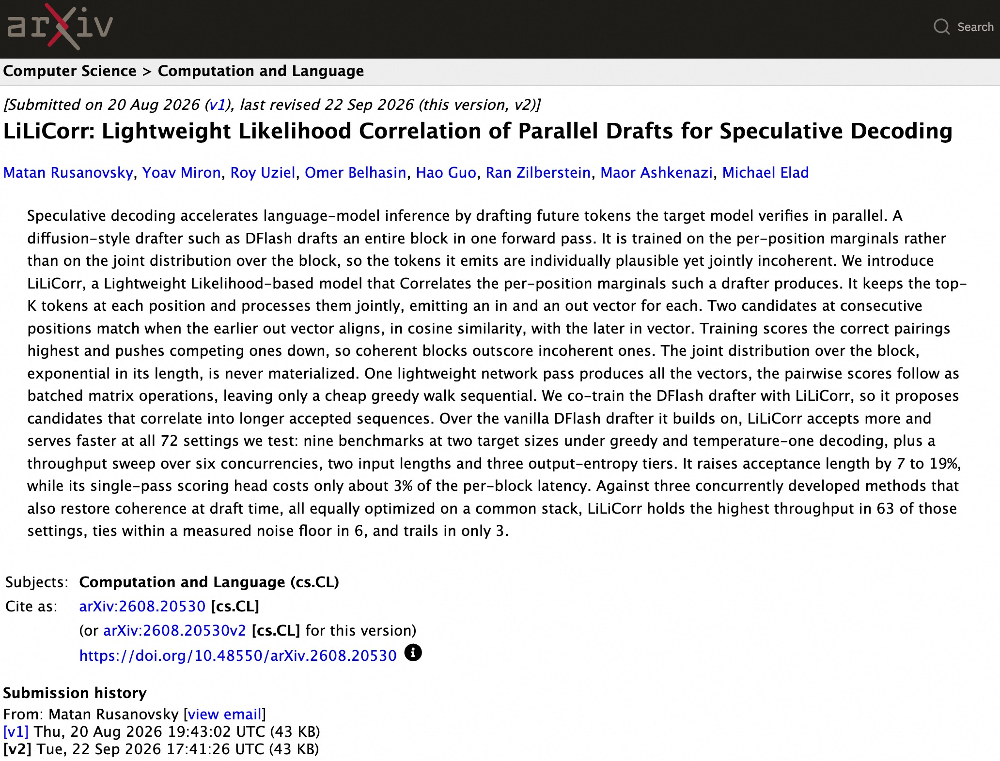

翻译最后一张图论文的标题和摘要

**解读**

**标题**

LiLiCorr：面向推测解码的并行草稿轻量级似然关联

**摘要**

推测解码通过预先生成未来词元，再由目标模型并行验证这些词元，从而加速语言模型推理。DFlash 等扩散式草稿模型能够在一次前向计算中生成整个词元块。然而，这类模型训练时学习的是各个位置的边缘分布，而非整个词元块的联合分布，因此生成的词元单独来看合理，组合起来却可能不连贯。我们提出 LiLiCorr，一种基于似然的轻量级模型，用于对这类草稿模型产生的各位置边缘分布进行关联建模。

LiLiCorr 保留每个位置上概率最高的 K 个候选词元，并对它们进行联合处理，为每个候选词元生成一个“入”向量和一个“出”向量。对于相邻位置上的两个候选词元，如果前一个候选的“出”向量与后一个候选的“入”向量具有较高的余弦相似度，则认为二者匹配。训练过程提高正确配对的得分，并压低竞争配对的得分，使连贯词元块的得分高于不连贯词元块。整个词元块的联合分布规模随块长度呈指数增长，但我们始终无需显式构建它。轻量级网络只需一次前向计算即可生成全部向量，随后通过批量矩阵运算计算候选之间的配对得分，仅保留计算开销很小的贪心路径搜索作为串行步骤。

我们将 DFlash 草稿模型与 LiLiCorr 联合训练，使其提出的候选词元能够相互衔接，形成更长的、可被目标模型接受的序列。相较于作为基础的原版 DFlash 草稿模型，LiLiCorr 在全部 72 种测试配置中都能让更多草稿词元被接受，并实现更快的推理服务。这些测试包括：在九个基准上，针对两种目标模型规模，分别采用贪心解码和温度为 1 的解码；此外，还在六种并发水平、两种输入长度和三档输出熵条件下开展吞吐量测试。LiLiCorr 将接受长度提高了 7% 至 19%，而其单次前向计算的评分头仅占每个词元块处理延迟的约 3%。

我们还将 LiLiCorr 与另外三种同期开发、同样在草稿生成阶段恢复连贯性的方法进行比较，所有方法均在统一的实现栈上进行了同等程度的优化。在上述测试配置中，LiLiCorr 在 63 种配置下取得最高吞吐量，在 6 种配置下与最佳结果的差异处于实测噪声范围内，仅在 3 种配置下落后。

### 问答 2

**问题**

dig看看最后一张图论文 举一个具象例子解释论文specdec如何发挥作用

**解读**

最后这篇 **LiLiCorr** 的关键是：**让并行草稿里的词彼此配套，而不是各猜各的**。比如续写“The”，小模型同时猜后面几个位置，可能拼出“dog meows sweetly”（狗甜甜地喵叫）：每个词单看都合理，组合却不协调。LiLiCorr 保留各位置的多个候选，用一次轻量网络计算相邻候选的搭配分数，再依此串出更连贯的草稿，例如“dog barks loudly”。([research.nvidia.com](https://research.nvidia.com/labs/nemotron/lilicorr/)) 假设这恰好符合大模型的贪心输出，大模型一次前向计算就能并行验证并接受整段；若中途不匹配，就只接受出错前的前缀。加速来自“花很少成本整理草稿，让一次验证通过更多词”，而不是让大模型放松检查。([arxiv.org](https://arxiv.org/html/2608.20530v2))

---

## 09. 现在看来，之前那篇“3090 抢购潮”预警帖终于说得通了。（讨论热度：405）

### 新闻背景

图片是一则 X/Twitter 帖子的截图。该帖声称，RTX 3090 的一个“gpu-unlock”内核／模块能够大幅提高 **BF16 张量运算吞吐量**，例如将 BF16 张量计算管线的性能从 **82 提升至 155 TFLOPS**，将 cuBLAS BF16 GEMM（通用矩阵乘法）的性能从 **64 提升至 99 TFLOPS**。据称，其原理是解除 NVIDIA 对使用 FP32 精度进行累加的张量运算施加的限制。

Reddit 原帖作者由此询问：这是否解释了此前的“3090 抢购潮”预警？过去为限制挖矿或区分产品档次而设置的限制，是否仍在影响大语言模型工作负载？不过，评论者指出，**BF16／GEMM 合成基准测试中的性能提升，不一定能转化为实际推理或训练的加速**。

对于市场炒作的说法，评论者普遍持怀疑态度。有人将“二手 3090 会比 5090 更贵”的预测斥为“痴人说梦”；另有人引用此前的反驳，指出这一修改尚未展示出实际工作负载中的性能收益。讨论中的主流态度较为谨慎：这些基准测试数据值得关注，但所谓“速度达到 1.9 倍”，落实到端到端任务时，提升可能小得多。

几位评论者认为，传闻中的 RTX 3090“破解”被过度炒作了，因为测得的收益似乎仅限于工作负载中的一个狭窄环节：**预填充（prefill）阶段大约提升 10%–12%**，而不是实际大语言模型推理普遍达到 **1.9 倍速度**。其中一人链接了此前讨论中的高赞反驳，强调底层 BF16 运算看似显著的提升，目前尚未转化为实际端到端工作负载中的相应收益。

另一个技术疑问是，**BF16 运算可能只占推理耗时的一小部分**。因此，除非真正的瓶颈是 BF16 计算，而不是内存带宽、KV 缓存访问、采样或其他内核，否则加速或解锁 RTX 3090 的 BF16 路径，对整体性能的影响仍然有限。还有评论者指出，能否采用这一修改，也取决于它是否可以安全实施，以及在 CUDA 和 NVIDIA 驱动更新后能否继续稳定运行。

在价格方面，评论者不太相信这条消息会让二手 RTX 3090 的价格明显飙升。他们认为，GPU 定价更多受大规模行业供货合同和新显卡市场定位影响，而不是小众大语言模型爱好者的需求。有评论拿一款售价约 **2,000 美元、配备 32GB 显存的全新 Radeon RX 9700 级别显卡**作比较，认为它可能比价格被炒高的二手 3090 更划算。不过，讨论并未通过深入的基准测试来验证这一比较，其准确的产品名称和性价比说法也没有得到充分核实。

### 问答 1

**问题**

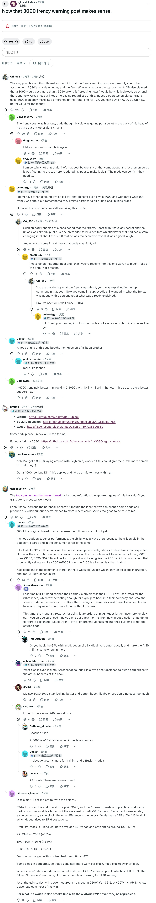

翻译最后一张图

**解读**

以下为最后一张图的翻译，保留评论顺序，省略点赞数等界面信息。文中的技术判断和推测均为原评论者的说法。

**标题：现在，那篇关于“3090 抢购狂潮”的预警帖终于说得通了。**

原帖已被作者删除。

**Ori_553：**

你这个标题的措辞，让我怀疑之前那篇“抢购潮预警帖”可能就是你用另一个账号发的，顺便还在 eBay 上卖 3090。而且，所谓的“秘密”早就在那篇帖子的最高赞评论里解释过了。

那篇原帖的作者还声称，一旦这条“重磅消息”被曝光，3090 就会比 5090 更贵。当时是痴人说梦，现在也是。

不管有没有这件事，GPU 价格都会继续上涨。这个行业靠的是大额采购合同，eBay 上那些二手 3090 对整体趋势没什么影响。而且，花大约 2000 美元就能买一张全新的 32GB RX 9700，性价比更好。

**GowsenBerry：**

那篇抢购潮帖子太搞笑了。那哥们居然以为，只要自己再透露一点细节，英伟达就会朝他后脑勺开一枪，哈哈。

**dragonurtle：**

这让我又想重看电影《π》了。

**sn2006gy：**

我肯定不是那个人。这些事情发生之前，我就没再关注那个帖子了，只是记得它之前经常浮到这个社区的热门位置。

我已经更新了自己的帖子，把这件事说明白了。版主如果有需要，可以核实。

**sn2006gy：**

我没有其他账号。我就是个连 3090 都没有的老家伙，只是想知道那场“抢购狂潮”到底是怎么回事，同时想起了挖矿热潮最火的时候，他们确实曾经对显卡做过一阵限制。

我已经更新了帖子，因为你们实在把这事想得太过头了。

**Ori_553：**

这个标题具体得有点古怪。毕竟，那篇“抢购潮”帖子根本没什么秘密，解锁方法早就公开了。但那个人却装成一个犹豫不决的吹哨人，说自己掌握了足以改变整个 3090 生态的情报，又害怕得不敢透露。确实挺好笑的。

现在你又跑过来，暗示那哥们当时说对了，哈哈。

**sn2006gy：**

我早就不再关注另一个帖子了，而且我觉得你对这个帖子过度解读得太严重了。摘掉你那顶阴谋论的锡纸帽吧，老兄。

**Ori_553：**

你说自己想知道那场抢购潮是怎么回事，可那篇帖子的最高赞评论早就解释清楚了。

现在你又出现了，声称自己依然不知道是怎么回事，还附上一张截图，内容正是之前已经解释过的东西。

兄弟，我大概从 2014 年就开始用 Reddit 了。

**sn2006gy：**

哈哈，“兄弟”，你真的想太多了。不是所有人都像你一样，整天泡在网上。

**Dany0：**

兄弟，这个社区里有相当一部分人的显卡都是从阿里巴巴买的。

**philmarcracken：**

更准确地说，是淘宝。

**Bpthewise：**

RX 9700 真的更好吗？我现在用的是两张通过 NVLink 连接的 3090。如果这是真的，我马上就卖掉它们。现在的软件支持更好了吗？

**pmttyji：**

GitHub 项目：`https://github.com/Zagitta/gpu-unlock`

vLLM 相关讨论：`https://github.com/noonghunna/club-3090/issues/1755`

推文：`https://x.com/superalesha/status/2112894407036809562`

谁来帮我把 4060 也解锁一下吧。

找到了一个适用于 3080 的分支：`https://github.com/Kz2g1ew-commits/rtx3080-egpu-unlock`

**teachersecret：**

哦，我有一张闲置的 12GB 3080 Ti，不知道这个方法能不能让它再多发挥一点性能 :)

我还有一张 4090，但不知道这个方法是否适用，而且我也不太敢乱折腾它 :p

**geldonyetich：**

那篇“抢购潮”帖子的最高赞评论给出了一个很好的反驳：这种破解看起来带来的性能提升，目前还没有转化成实际工作负载中的收益。

我也说不准，也许确实有潜力？但“改几行代码，就能突然获得超越更新款显卡的性能”这种说法，对我来说实在好得不像真的。

**Dany0：**

原帖作者的意思是：那是因为完整解锁还没有发布。

这不是突然冒出来的更强性能，这种能力一直都在，因为数据中心显卡和消费级显卡使用的是相同的芯片裸片。

之前看起来连流式多处理器（SM）都可能被解锁，但今天的最新进展表明，这件事没有预想的那么有希望。

不过，指令解锁是真的。一旦所有指令都解锁，所有 GA102 GPU，也就是 3080、3090 和 3090 Ti，在预填充和训练中的表现就会像 A40 一样。顺带一提，A40 现在是几乎买不到的稀罕货，售价大约在 4000～6000 美元之间，不过目前 A100 反而更划算。

另外，那边评论区有人运行了三周前的解锁版本，那个版本只解锁了一条指令。如果我没记错，他获得了 38%～48% 的加速。

**SorosAhaverom：**

英伟达上一次通过驱动限制显卡性能，是给 30 系显卡加上 LHR，也就是“低哈希率”限制。利益诱惑足够大，以至于有个团体入侵了他们公司，偷走源代码，然后解除了 LHR 限制。

当时挖矿软件的开发者说，这就像大海捞针，如果没有那次泄露，他们根本不可能找到。

这一次，破解带来的经济回报高了好几个数量级，简直难以想象。

如果几个月后出现新闻，说某个国家开展商业间谍活动，类似“沙特与 OpenAI”那种情况，或者直接入侵他们的系统窃取源代码，我一点也不会意外。

**IntelArtiGen：**

或者用 AI 来破解 GPU，自动反编译英伟达驱动。如果限制就藏在驱动里的某个地方，那就让 AI 把它修掉。

**a_beautiful_rhind：**

到底还有什么东西是被锁住的？

截图里的说法更像是在炒作、故意推高显卡价格，而不是在讲这种破解实际能带来什么收益。

**grumd：**

我那两张 20GB 3080 看起来越来越香了。希望阿里巴巴上的价格别涨太多。

**KPOTOB：**

我也不知道，我的 A40 感觉挺慢的 :(

**Caffeine_Monster：**

因为它本来就慢啊？

3090 大约快 25%，只不过显存更少。

**Dany0：**

解码阶段确实如此。A40 更适合训练和扩散模型。

**vman81：**

A40 俱乐部！我们可是有好几十个人呢！！

**Liberaces_Isopod：**

先声明一下：下面这些文字是我让机器人代写的……

仅供参考，我刚刚在一张普通 3090 上做了端到端测试。对于“无法转化成实际工作负载收益”这个说法，现在已经能测出实际收益了，但前提是工作负载的瓶颈确实在预填充或 BF16 计算上。

同一张显卡、同一个模型、同样的功耗上限、同样的频率，唯一的区别就是是否解锁。

模型是一个以 W4A16 运行的 27B 模型，使用 vLLM，反量化后使用 BF16 激活值。

下面是预填充速度，单位为 token/秒，数值从原厂状态到解锁状态。两组测试的功耗上限都是 420W，频率都在 1920MHz 左右。

2K：1344 → 2062，提升 53%。

10K：1306 → 2016，提升 54%。

90K：909 → 1383，提升 52%。

解码速度没有变化，差异处于测量噪声范围内。最高温度从 84℃ 升到了 87℃。

两组的频率相同，所以这确实是每个时钟周期完成了更多工作，不是频率或功耗差异制造出来的假象。

哪些场景看不到提升？瓶颈在解码阶段的工作负载，以及 GGUF／llama.cpp 的预填充，因为后者不是 BF16 计算。因此，“不能转化成实际收益”这个判断，对大多数用户来说是对的，但对 BF16 推理服务来说就不对了。

另外，提升幅度也取决于功耗余量。功耗上限设为 250W 时，提升是 36%；设为 420W 时，提升是 54%。较低的功耗上限会吃掉大部分收益。

**顺便说一句，它也能与 aikitoria 的 P2P 驱动分支一起使用，没有出现性能退步。**

---

## 10. ornith-ai/Ornith-1.5-122B（Qwen 微调版）｜活跃度：438

### 新闻背景

Ornith AI 发布了 **Ornith-1.5-122B**，这是一款拥有 **1220 亿参数的混合专家（MoE）推理模型**。它沿用源自 Qwen 3.5／Gemma 的模型谱系，在 Ornith-1.0 的基础上进行微调或继续训练。其自我改进循环通过强化学习，联合优化任务生成、智能体框架构建与解题轨迹生成，而不只是依赖由人类整理的固定任务集。

发布的模型文件包括 **GGUF、Unsloth GGUF 和 NVFP4** 等版本。模型卡宣称，它在编程与智能体基准测试中表现出色，支持 **262K（约 26.2 万）token 的上下文窗口**，并可选择通过 YaRN 扩展至约 **100 万 token**。部署方面，支持 vLLM、SGLang 和兼容 OpenAI 的 API，也支持通过 llama.cpp、Ollama 等方式运行 GGUF 版本。

评论者质疑，为什么选择 **Qwen 3.5 122B** 作为基础模型，而不是更新的“Next Flash”类模型，认为它可能已经落后于较新的架构。一个技术层面的担忧是推理速度：由于它基于 Qwen 3.5 122B，拥有 **100 亿活跃参数（A10B）**，而且没有稀疏注意力，一位评论者估计，其推理速度大约只有拥有 **60 亿活跃参数（A6B）** 的 Q3.8fn 类模型的一半。

一位评论者指出，这个微调模型基于 Qwen 3.5 122B，因此对于使用 q3.8fn 的用户而言，它对应的是 A10B 而非 A6B 的活跃参数规模，并且不支持稀疏注意力。该评论者估计，在这种配置下，推理速度会慢约一倍。

对于基础模型的选择，也有人表达了技术上的怀疑：一位评论者询问，为什么不基于 **Ornith Next Flash** 构建。他认为，虽然 Qwen 3.5 是一个实力不错的基础模型，但与更新的替代方案相比，它已经被“远远甩在后面”。

### 问答 1

**问题**

dig看看最后一张图 检索提供ornith模型vs.原版qwen哪些地方变动较大的bg-info

**解读**

查了官方模型卡和配置，**Ornith-1.5-122B 的大改主要在训练，而非架构**：仍保留原版 Qwen3.5-122B-A10B 的混合注意力、MoE、约10B激活参数和262K上下文，MTP也不是新加的。([huggingface.co](https://huggingface.co/ornith-ai/Ornith-1.5-122B/blob/main/config.json)) 真正变化是追加续预训练、中期训练与后训练，并用强化学习联合优化“自己生成任务→搭建工具和执行脚手架→生成解题过程”，不只是拿固定问答做微调；官方强调指令遵循、任务拆解更强、输出更短。([huggingface.co](https://huggingface.co/ornith-ai/Ornith-1.5-122B/blob/main/README.md)) 自测中最突出的差距是 SWE-bench Pro：76.9 对 43.9，但对手是 **Qwen3.8-Flash-Next，不是原版3.5**，不能直接当作相对底座的提升幅度。([huggingface.co](https://huggingface.co/ornith-ai/Ornith-1.5-122B)) 图里“慢两倍”同样不能定论，推理器和是否启用投机解码会明显影响实测速度。([github.com](https://github.com/incoai/splash/issues/528))

---

## 11. RecursiveSI/flint（40B 总参数，2.5B 激活参数）· Hugging Face（活跃度：784）

### 新闻背景

RecursiveSI/flint 是发布在 Hugging Face 上、采用 Apache-2.0 许可证的纯解码器混合专家（MoE）编程智能体模型。它共有 398 亿参数，但每个 token 仅激活约 25 亿参数。模型采用 49 层结构，每个 MoE 层包含 256 个路由专家，每个 token 选择其中 6 个；混合使用滑动窗口注意力和全局注意力，文档标注的上下文长度为 26.2 万 token。

Recursive 公布的成绩为：Terminal-Bench 2.1 上 54.9%，SWE-bench Pro v2 上 89.7%，SWE-bench Verified 上 74.2%。模型面向在 B300/H200 GPU 上通过 SGLang 部署推理服务的场景，并支持兼容 OpenAI 接口的工具调用。评论者认为，它大致属于大家原本希望 Qwen 3.8 推出的“35B-A3B”级别模型，但 Qwen3.8-27B 已经问世，使这次发布显得没那么令人惊喜。除此之外，基准测试截图是主要的技术讨论焦点。

评论者将 Recursive Flint 定位为总参数约 400 亿、激活参数仅 25 亿的 MoE 模型，大致符合部分用户期待的“350 亿总参数、30 亿激活参数”稀疏模型类别。不过，它如今需要与 Qwen3.8-27B 等激活参数较少的新一代 MoE 模型竞争。帖子指出，如果没有 Qwen 最近的发布，Flint 很可能会被视为一次重要得多的模型发布。

NVIDIA 在 GTC 柏林大会上的一篇技术公告将 Flint 描述为针对 RTX Spark 优化的本地编程模型，声称其在 64GB 版本的 RTX Spark 上生成速度超过 **220 token/秒**，并在 SWE-bench Pro v2、Terminal-Bench 2.1 和 SWE-bench Verified 等智能体编程基准测试中取得了优异成绩。相关内容见 [NVIDIA 公告](https://blogs.nvidia.com/blog/local-ai-gtc-rtx-dgx-spark-station-sync/)。

NVIDIA 表示，Flint 是借助 Recursive 的 **Eureka Machine** 构建的。这是一套自动化 AI 研究循环，能够提出想法、实现方案、运行实验，并选择后续研究方向。所引用的文章声称，该系统开发出了专用计算内核，在**不改变模型权重**的情况下，将 Flint 在 RTX Spark 上的生成速度提升了 **55%**。文章还指出，模型权重以 Apache-2.0 许可证开放，并支持通过 NeMo Automodel 进行 SFT/LoRA 后训练，以及通过 NeMo RL 进行 GRPO 训练。

---

## 12. 支持声音克隆的 Pocket TTS，如今仅需190万参数（热度：561）

### 新闻背景

Kyutai 发布了 **Pocket TTS-small**，将一套可在 CPU 上实时运行、支持声音克隆的文本转语音（TTS）系统，从约 **1亿参数**压缩为 **1820万、690万和190万参数**三个版本。

其压缩流程包括：从约3亿参数的教师模型进行蒸馏，将无分类器引导（CFG）内化到单次前向计算中，利用主成分分析（PCA）构建主干网络与输出头之间的64维潜在表示接口，对 Transformer 进行结构化剪枝，分别蒸馏主干网络、输出头和编解码器，以及可选的基于奖励的微调。据报告，1820万参数版本在 CPU 上的语音生成速度约为实时播放速度的 **9.9倍**，190万参数版本则约为 **25倍**。1820万参数版本在词错误率（WER）和 UTMOS 语音质量指标上，与原版持平或略优。

评论者对压缩方法的关注较少，更多在讨论已发布模型或演示中疑似存在的粗口过滤现象。例如，“What the fuck”被合成为“What the dee”。不过，后续更新称团队已经修复了这一问题。其他用户希望看到更严格的评测，涵盖自然度、实时因子，以及不同说话人的声音相似度，尤其是在完全本地推理的条件下。

**输出异常：** 多名用户报告，TTS 输出疑似出现了文本审查或功能退化，例如将“What the fuck”读成“What the dee”。获赞最高的评论者随后表示，团队已处理此问题并发布修复。这表明，它可能是模型、分词或过滤环节中的非预期行为，而非长期执行的政策选择。

**评测需求：** 一位评论者指出，190万参数这个数字确实令人印象深刻，但仍需要具体的评测数据，包括自然度、实时因子，以及不同说话人的声音相似度。他们强调，小型 TTS 模型最有吸引力的前提，是能够在不牺牲声音克隆质量的情况下，实现完全本地推理。

**多语言支持：** 一名用户报告，模型对非英语语言的支持较差，声称非英语输入实际上被读成了英语，而不是目标语言。这说明，尽管存在更广泛的 TTS 或声音克隆能力宣传，其多语言能力仍可能较弱，甚至不具备。

### 问答 1

**问题**

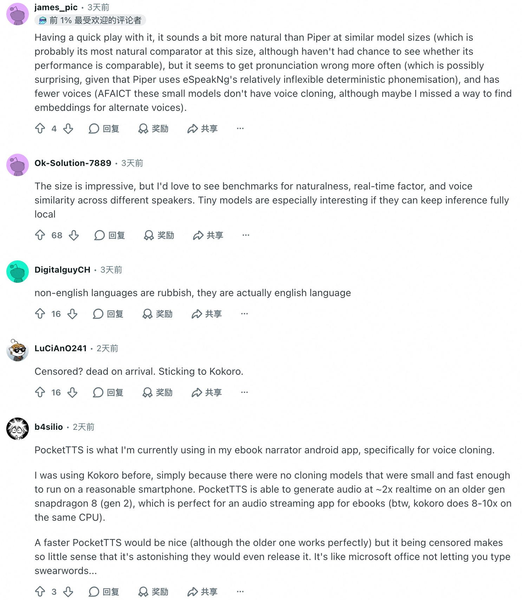

翻译最后一张图

**解读**

**james_pic**

简单试用了一下，在模型大小差不多的情况下，它听起来比 Piper 更自然一些。Piper 可能是这个体量下最适合拿来比较的模型，不过我还没来得及比较两者的性能。

但它似乎更容易读错音。考虑到 Piper 使用的是 eSpeak NG 那套相对死板、确定性的音素转换机制，这一点可能有些出人意料。另外，它可选的音色也更少。据我目前所知，这些小模型似乎不支持声音克隆，不过也可能是我没找到用于其他音色的嵌入向量。

**Ok-Solution-7889**

这个体积确实很惊艳，但我希望看到自然度、实时因子，以及针对不同说话人的声音相似度等方面的基准测试。如果能完全在本地运行，这类超小模型就尤其值得关注。

**DigitalguyCH**

非英语支持很差，输入其他语言，出来的实际上还是英语。

**LuCiAn0241**

还搞内容审查？那一发布就没戏了。我还是继续用 Kokoro。

**b4silio**

我目前就在自己的 Android 电子书朗读应用里使用 PocketTTS，主要用它做声音克隆。

以前我用的是 Kokoro，原因很简单：当时还没有足够小、足够快、能在普通智能手机上运行的声音克隆模型。PocketTTS 在较老的骁龙 8 Gen 2 上，生成音频的速度能达到约两倍实时速度，对电子书音频流式播放应用来说正合适。顺便说一下，Kokoro 在同一颗 CPU 上能达到八到十倍实时速度。

更快的 PocketTTS 当然很好，虽然旧版已经运行得非常好了。但它居然会审查文本，实在毫无道理，让人难以相信他们竟然会发布这样的版本。这就像微软 Office 不让你输入脏话一样……

---

## 13. **独家：字节跳动、阿里巴巴和腾讯下单采购超过350亿美元的英伟达芯片**（活跃度：1047）

### 新闻背景

**独家：字节跳动、阿里巴巴和腾讯下单采购超过350亿美元的英伟达芯片**（活跃度：1047）

路透社报道称，字节跳动、阿里巴巴和腾讯已向英伟达下达总额超过350亿美元的芯片订单。Reddit帖子将其描述为：中国订购了约300万张RTX PRO 5500显卡，单价约11,400美元，可能主要用于大语言模型推理和AI视频生成。不过，一位被引用的消息人士表示，英伟达可能只能满足所需数量的5%—10%；2027年RTX PRO 5500的全球产量最多为300万张，而中国客户的需求超过600万张。

评论者认为，供应限制意味着这些订单不太可能全部交付。有人推测，随着数据中心需求占据主导地位，英伟达可能降低利润率较低的工作站显卡的供应优先级。也有人怀疑，即使未来推出新一代GPU，目前的RTX PRO显卡也未必会降到本地大模型用户能够负担的价格；不过，部分人仍希望数据中心的设备更新周期能够压低二手市场价格。

**供需严重失衡**

评论者强调了报道中提到的巨大供需缺口：英伟达向合作伙伴分配的产品数量，可能仅相当于其申请数量的5%—10%。一位消息人士称，2027年RTX PRO 5500的全球产量不会超过300万张，而中国客户的订单数量已超过600万张。这意味着，超过350亿美元的订单总额可能受到严重的供应限制，不能视为能够全部兑现交付的需求。

**单价纠正与供应优先级**

有评论纠正了价格计算：推算出的单价约为每张11,400美元，而不是11.40美元，这才与高端专业级、数据中心GPU的定价相符。另一个值得关注的问题是，利润更高的企业级需求可能让英伟达更倾向于把供应分配给数据中心；即使是售价16,000美元的RTX 6000 Pro，也未必能获得优先供货。

**专业级需求可能挤压消费级显卡供应**

一些评论者推测，GB202级别的芯片可能被更多地用于RTX PRO等专业级产品，或符合出口规定的型号，从而减少RTX 5090等消费级GPU的供应。其核心担忧是：数据中心和专业市场的需求可能持续挤占游戏显卡的供应，直到更新一代产品让市场需求不再集中于当前这代芯片。

### 问答 1

**问题**

dig看看最后一张图 检索提供中国公司why采购rtx pro 5500这一特定型号gpu的bg-info

**解读**

核心是**“出口合规、推理够用”**，而不是 RTX PRO 5500 比旗舰 AI 芯片更强。路透社2026年10月20日报道，B300禁止售华、H200仍须逐案许可，而5500是中国客户仍可采购的较强英伟达GPU之一。([money.usnews.com](https://money.usnews.com/investing/news/articles/2026-10-20/exclusive-bytedance-alibaba-tencent-place-over-35-billion-worth-of-nvidia-chip-orders)) 字节、阿里和腾讯主要想补充的是**AI推理算力**——运行已经训练好的模型，而非用工作站卡替代最顶级的训练集群。([ndtvprofit.com](https://www.ndtvprofit.com/technology/banned-from-top-ai-chips-china-just-dropped-35-billion-on-this-nvidia-gpu-12210396)) 技术上，它有84GB GDDR7显存、支持FP4低精度计算，适合部署较大的量化模型；英伟达也明确将其定位于大模型推理和AI智能体工作负载。([nvidia.com](https://www.nvidia.com/en-us/products/workstations/professional-desktop-gpus/rtx-pro-5500/)) 因此，这更像是高端卡受限、业务算力需求又持续增长时的现实折中，不能理解成三家公司认定“5500是全球性价比最优的GPU”。

---

## 14. **做好准备，GPU 即将涨价：三星 2027 年的 HBM 产能已全部售罄，预计明年 HBM 价格上涨 200%，DRAM 价格出现两位数涨幅**（活跃度：1…

### 新闻背景

**做好准备，GPU 即将涨价：三星 2027 年的 HBM 产能已全部售罄，预计明年 HBM 价格上涨 200%，DRAM 价格出现两位数涨幅**（活跃度：1227）

据 GSMArena 报道，三星据称已通过与大型科技客户签订多年期大额合同，预售了明年约 **70% 的通用 DRAM 产量**和 **100% 的 HBM（高带宽内存）产能**。由此造成的内存供应紧张，预计将推动 HBM 价格上涨 **150%—200%**，并使 DRAM 价格在 **2027 年第一季度出现两位数涨幅**，增加 GPU、AI 加速器以及未来 Galaxy 手机等下游设备的物料成本压力。评论者预计，HBM 供应紧张将进一步降低消费级和本地 AI 用途 GPU 的可负担性。他们也指出了其中的相互依赖：前沿模型需要超大规模 GPU 集群，而本地推理用户也在争夺同样紧缺的内存供应。有人认为，硬件短缺可能迫使行业转向更小、更高效的模型，并延长硬件的使用周期。

多位评论者将三星 2027 年 HBM 产能据称已售罄，以及预期中的 HBM、DRAM 涨价，与本地 AI 硬件的成本效益恶化联系起来：本地推理用户需要 GPU，但超大规模云服务商和 AI 实验室也在大量采购，用于训练和数据中心扩建。一位评论者指出，即使配套的数据中心容量尚未建成，GPU 采购似乎也已在加速。这意味着，囤积硬件库存可能让消费级和高端个人用户 GPU 的供应持续紧张数年。

讨论中还有一个技术与经济层面的观点：随着 GPU 和内存价格上涨，而部分云端 AI 服务变得更便宜，**本地 AI 设备相对于云端推理的回本门槛已经提高**。这位评论者特别认为，**MoE（混合专家）模型**会放大这一现象，因为数据中心能够在大量用户之间复用稀疏激活的专家，更高效地利用资源；相比之下，个人为了本地运行模型而购置昂贵、需要大量显存的硬件，往往更难在经济上证明其合理性。

一位评论者认为，硬件短缺可能推动模型端的优化，激励行业开发**更小、更高效的模型**，而不是单纯增加参数量和内存带宽。这意味着，高昂的 HBM 和 GPU 价格可能加速模型压缩、量化、蒸馏、稀疏架构以及推理效率优化等方面的研究。

---

## 15. **Claude Duet：Anthropic 不声不响地推出了个人助理，称其为“主动式智能体”。这是对 Muses、Bots 和 Dots 的回应。**（活跃…

### 新闻背景

**Claude Duet：Anthropic 不声不响地推出了个人助理，称其为“主动式智能体”。这是对 Muses、Bots 和 Dots 的回应。**（活跃度：1,306）

图片是 Claude 在 X/Twitter 上发布公告的截图，介绍了研究预览版应用 **Claude Duet**。它将 Claude 定位为主动式个人智能体，而非单纯通过聊天提供帮助的助手。公告称，Duet 可以主动提示需要关注的事项，在用户离开时异步完成交办的任务，并在代表用户采取行动之前请求确认。一位评论者提到，据称它将面向订阅了 20 美元套餐的用户开放。评论区反应不一：有人表示，这与自己目前使用 Claude 的方式相同，并质疑 Duet 与 Muses、Bots、Dots 等其他智能体或应用有何区别。另一条热门评论只是一个非技术性的玩笑，没有提供实质性的技术信息。

评论者指出，Claude Duet 似乎包含在 Anthropic 现有的 **每月 20 美元订阅套餐**中。这表明，Anthropic 正把主动式智能体或助手功能纳入面向普通付费用户的 Claude 服务，而不是将其作为独立的企业专用产品。

一些技术层面的批评认为，Anthropic、OpenAI 等厂商目前推出的“助手”，看起来仍然只是**给不同的前沿模型套上了一层简单的聊天机器人外壳**，而非本质上全新的智能体系统。用户质疑，Claude Duet 究竟与他们现有的 Claude 个人工作流，以及 Muses、Bots 等类似助手方案有何不同。

一位评论者认为，当前缺失的未必是模型能力，而是**结构化的个人数据整合与产品功能编排**。真正有用的助手需要更完善的数据结构、上下文管理，以及与外部服务的集成。他们认为，所需技术已经存在，但需要将这些技术整合成连贯、完整的助手体验，而不是再做一个通用聊天界面。

---

## 16. 我用 Claude 修好了三星电视（活跃度：3894）

### 新闻背景

一位用户称，他让 Claude 充当交互式智能体，确认三星电视运行的是 Tizen，而不是 Android。由于 Claude 无法直接访问摄像头，他通过搭建本地网页、生成指向本地服务器的二维码，再用手机摄像头每隔 4 秒拍摄一次电视画面，为智能体提供视觉反馈（二维码截图）。

据该用户描述，智能体花了约 30 分钟调整隐私和遥测设置、删除三星广告 ID、停用不使用的应用、重新排列图标，随后制作了一个定制的“Apple TV 风格”启动器／主屏幕应用，以及一个用于配置快捷方式和背景的配套设置应用（启动器、设置界面）。

一位高赞评论者介绍了类似的、面向客人的定制电视启动器方案：在客人抵达前收集偏好，个性化展示 Plex 内容、媒体和新闻，设置音乐、背景及欢迎画面，显示行程和天气，并通过 Home Assistant 控制户外照明、泳池增氧设备和喷雾装置。评论者主要惊讶于，这位用户竟然尝试让 Claude 如此自主地精简和定制电视系统。有人将其视为智能体突破常规编程辅助、实现界面自动化的实际案例。中途绕去看猫咪视频的插曲，则被当作趣事，而不是技术失败。

一位评论者描述了如何使用 Claude 构建或替换三星电视启动器，打造面向客人的定制界面：通过问卷收集偏好，个性化配置 Plex 电影、电视及新闻频道预设、背景音乐、天气、行程和本地推荐。他还将启动器与 Home Assistant 集成，让客人可以直接从电视主屏幕控制户外照明、泳池增氧设备、喷雾装置及其他智能家居设备。

另一位评论者建议，直接安装 `cleanyourtv`，避免专门搭建由 Claude 驱动的定制流程。这是一个在 GitHub 上获得约 15,000 颗星、用于清理和精简智能电视系统的项目。他认为，与让 Claude 逐步指导或生成电视修整流程相比，这种替代方案更快，也更节省 token。

还有人特别指出，用户删除了电视的广告 ID。这意味着原先借助 Claude 完成的修整不仅涉及界面调整，还包括隐私保护和系统精简。这被认为是一项值得关注的、以隐私保护为目的的三星智能电视改造。

---

## 17. 技术新闻 17

### 新闻背景

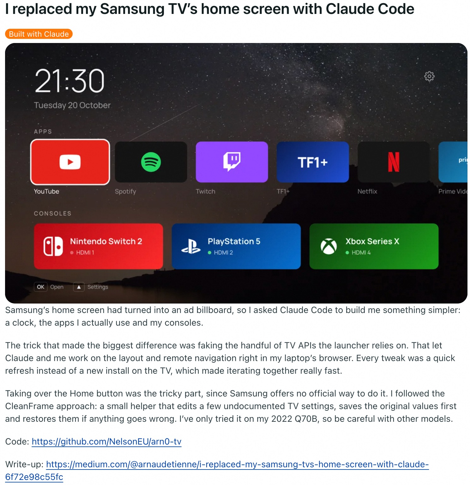

**我用 Claude Code 替换了三星电视的主屏幕（活跃度：1069）**

图片展示了一个自定义三星电视启动器，用简洁的网页风格界面替换了原本广告密集的主屏幕。界面包含时钟与日期、选定的应用卡片、游戏主机快捷入口、设置，以及遥控器操作提示。作者表示，Claude Code 帮助他构建了这个启动器，并通过在笔记本电脑的浏览器中模拟三星电视 API，加快了开发迭代。据称，接管遥控器 Home 键的功能使用了一个类似 CleanFrame 的辅助工具，通过修改未公开说明的电视设置实现；该方案仅在一台 2022 年款三星 Q70B 上测试过。代码已发布到 GitHub，另有一篇更详细的介绍文章。

评论区总体持怀疑态度，观点也较为两极分化。一位评论者称赞这个项目能够避开三星和 LG 的遥测数据收集与广告，其他人则怀疑这是重复发布的垃圾推广或诈骗内容，也有人觉得这类帖子已经看腻了。

评论者提出了三星和 LG 专有智能电视软件的隐私与安全问题，认为用开源界面或操作系统替代它们，可能减少厂商的数据收集和不必要的追踪。不过，一个值得注意的技术风险是：如果不了解电视平台在启动和更新方面的限制，就直接部署通过“氛围编程”（vibe coding）生成的电视固件或主屏幕替代程序，可能导致设备“变砖”，无法正常使用。

一段围绕安全问题的讨论警告说，鼓励用户运行未经审查的电视代码，可能形成很大的攻击面。如果替代启动器或脚本被攻击者篡改，就可能被用来同时远程控制大量电视，例如强制多台设备播放攻击者指定的视频。

还有一位用户询问，替换三星主屏幕后，是否带来了可测量的延迟改善，并吐槽原厂电视启动器“慢得要命”。他还提到使用 Claude 安装 Jellyfin，关注的是：与电视厂商原有的智能电视软件相比，AI 生成的启动器能否让本地媒体使用体验更加流畅、响应更快。

---

## 18. **我把一个包含1100万篇新闻文章的数据库交给 Claude Code，它发现了一些奇怪的规律**（活跃度：1604）

### 新闻背景

**我把一个包含1100万篇新闻文章的数据库交给 Claude Code，它发现了一些奇怪的规律**（活跃度：1604）

配图是一张技术仪表盘截图，而不是梗图。它展示了 CLSTR 的深色主题地图“此刻的世界”：系统通过新闻采集与处理流程，按国家直观呈现当前全球的事件数量。作者在帖子中表示，该系统每天处理约10万篇文章，来自4万多个来源，涵盖40种语言，再将这些文章聚类为不同事件。在累计处理11,079,667篇文章后，系统提供了基于这些数据的分析结果。截图显示，过去3小时内，161个国家共出现2703个事件，并突出展示了一个包含673篇文章的大型新闻聚类：“法国在大范围社会动荡中实施宵禁”。

**需要澄清的是，Claude Code 并没有完整阅读1100万篇文章，而是查询或导出了作者的数据处理流程所生成、汇总后的聚类元数据。** 该流程使用了向量嵌入、启发式规则，以及一个大语言模型评判环节。

评论者围绕这种方法是否足以支撑相关结论展开了讨论。一部分持怀疑态度的人认为，Claude 很可能只是编写了启发式分析代码，而观察到的规律可能主要由来源选择和聚类偏差所决定。另一些人则更乐观，将其视为大语言模型智能体帮助人们从现实世界数据中发现大规模规律的一个案例。

几位评论者质疑，Claude Code 是否真的直接处理了1100万篇文章。他们认为，在如此大的规模下，完全依赖大语言模型进行分析，成本和耗时都可能高到难以承受。更合理的实现方式是，让 Claude 编写辅助代码或启发式规则，对文章库进行汇总和搜索。不过，评论者提醒，这些规则必须有明确的文档说明，因为它们可能对最终结果起决定性作用。

一个主要的方法论批评是，帖子没有充分说明数据采集、来源选择和抽样偏差。评论者指出，如果新闻来源是 Google 新闻或其他聚合平台，那么观察到的规律可能反映的是排序机制、地域差异、基于点击历史的个性化推荐，或来源可获取性方面的偏差，而非真实的媒体行为。

评论者还指出了潜在的语言和来源覆盖问题。例如，有人声称，无法识别语言的文章被标记成了英语；数据中似乎也缺少俄语、中文或韩语等主要非英语语料。他们认为，如果没有来源说明，也没有对语言标注进行验证，那么有关全球新闻规律的结论，在技术依据上就不够扎实。

---

## 19. **Waymo 自动驾驶出租车的严重事故比人类驾驶少95%，现计划将车队扩至2万辆**（热度：1457）

### 新闻背景

**Waymo 自动驾驶出租车的严重事故比人类驾驶少95%，现计划将车队扩至2万辆**（热度：1457）

Waymo 最新安全数据显示，其累计完成了2.713亿英里的无人驾驶载客行驶，每百万英里发生的重伤或死亡事故为0.01起，而通过建模得出的当地人类驾驶基准为0.21起。也就是说，严重事故发生率约低95%，造成人员受伤的事故发生率约低82%。

美国公路安全保险协会（IIHS）分析了2021至2024年的联邦事故数据，涵盖约5000万英里的无人驾驶行驶里程，也发现了方向一致的降幅：达到警方报告标准的事故减少68%，造成人员受伤的事故减少81%。不过，该分析指出，事故报告存在局限，而且奥斯汀地区的结果略差于人类驾驶基准。据媒体 Semafor 报道，Waymo 计划到2027年底将车队从约4000辆扩至2万辆，资金部分来自一笔50亿美元的债务融资。

评论者围绕这些基准是否构成同等条件下的比较展开争论。支持者认为，严重事故并不少见，因此这些降幅具有实际意义，而且 Waymo 很少是事故责任方。质疑者则指出，Waymo 目前的设计运行域（ODD）主要是密集城区、较低车速和有限的高速公路行驶。这与乡村、郊区或高速公路上的驾驶环境不同，而许多严重事故恰恰发生在这些环境中。

一位自称具有汽车制造商碰撞安全工程经验的评论者认为，Waymo 公布的安全结果与过去十年的自动驾驶研究一致：人类驾驶是一项高风险的日常活动，而自动驾驶系统总体上表现出较低的严重事故率。他强调，所报告的指标似乎统计的是**涉及的事故总量，而不是事故责任归属**。Waymo 经常只是卷入由人类驾驶员造成的事故，并非引发事故的一方。

另一位评论者担忧，不同驾驶环境带来的风险暴露差异可能造成比较偏差。据称，Waymo 车辆主要在密集城区运行，很少驶上高速公路，而高速公路上更容易发生高速碰撞和重伤事故。因此，**“严重事故减少95%”的结论未必能推广到乡村、郊区或经常在高速公路上行驶的场景**，因为这些场景中车速超过每小时50英里的情况更常见。

还有一位评论者指出，奥斯汀地区的事故率比较在统计上可能缺乏说服力，因为据称研究期间当地只发生了2起涉及 Waymo 的事故。他认为，这样的样本量太小，无法据此对 Waymo 在该地区究竟比人类驾驶更安全还是更不安全作出有力结论。

### 问答 1

**问题**

dig看看https://maccus.fr/en/waymo-robotaxis-serious-crashes/ 举一个向上班族推销robotaxi服务的具象例子

**解读**

比如向每天开车半小时上班的旧金山白领这样推销：“如果家和公司都在服务区，明早试试坐 Waymo：系好安全带，听音乐、整理日程，不用自己应付车流，也不用到公司后找停车位；晚上加班累了，更不必硬撑着开车。你买的不只是一次接送，而是把通勤从另一份工作，变成自己的时间。”安全卖点可以补充：Waymo自报数据显示，现有运营区域内严重伤亡事故率比当地人类驾驶基准低约95%，但这不是零事故保证，也不能直接推广到所有路况。([waymo.com](https://waymo.com/safety/impact/))

---

## 20. 宇树最新机器人：H2-X「功夫传奇守护者」（活跃度：3907）

### 新闻背景

宇树发布了 H2-X「功夫传奇守护者」。它似乎是 H2 人形机器人的一个更坚固、力量更强的变体，宣称最长续航约为 8 小时，并在 X 帖子中将其定位为“服务与守护”平台。

帖子还将其与其他中国人形格斗／娱乐机器人放在一起讨论，尤其是 Engine AI 的 T800。据链接文章介绍，T800 曾用于格斗赛事演示。不过，Reddit 上的视频因“403 Forbidden（禁止访问）”错误而无法观看。

热门评论较少关注具体参数，更多讨论安全与双重用途风险。有人调侃，演示中的机器人推孩子的力道似乎比一辆低速行驶的汽车还大，并以反讽的语气表示，希望这项技术“不会被滥用”。

---

## 21. **Fibo 2 Edit 才是 Klein 3 本该有的样子**（活跃度：1189）

### 新闻背景

**Fibo 2 Edit 才是 Klein 3 本该有的样子**（活跃度：1189）

一位 Reddit 用户表示，Fibo 2 Edit（Hugging Face 上的模型）是一款速度快、开箱即用且“不设内容审查”的图像编辑模型。在简单编辑中，他没有观察到色彩偏移或画质损失，并将部分画质提升归功于 Flux 2 VAE。他还附上了 ComfyUI 实验性支持的拉取请求 `Comfy-Org/ComfyUI#17240`，但后来更新称，这个模型在处理复杂提示词和多参考图编辑时表现不佳，“并不比 Qwen 更好，只是更快”。

评论区有人认为，Fibo 2 Edit 可能是“迄今最好的图像编辑模型”，主要理由是它不设内容审查；相关讨论也提出，内容审查可能降低模型的实用性。另一位评论者强调，开放权重图像模型正在快速进步，并提到即将推出或已经可用的 Ideogram 4、Krea 2、Qwen 2.1、LTX，以及可在消费级硬件上通过 ComfyUI 运行的量化版 Hunyuan Image 3。

用户认为 Fibo 2 Edit 是一款实力不错的图像编辑模型，并指出，据称它不设内容审查。一位评论者称其为“迄今最好的编辑模型”。讨论将它视为一种更广泛趋势的体现：在人们看来，限制较少的图像模型，在实际编辑效果上优于内容过滤更严格的替代模型。

**输出分辨率方面存在一个值得注意的技术限制：**据称，Fibo 2 Edit 会先将原图缩小到约 **100 万像素（1MP）**，再通过 Flux 2 VAE 处理，导致结果模糊。这说明，模型或当前处理流程的瓶颈可能在于预处理及 VAE 对分辨率的处理，而不只是对编辑意图的理解。

评论者还表达了对 ComfyUI 支持及整个开放权重生态发展的兴趣，提到的模型包括 Ideogram 4、Krea 2、Anima、Qwen 2.1、Moss Image、Ming Image、Minimax H3、LTX，以及量化版 Hunyuan Image 3。据称，后者有望在消费级硬件上通过 ComfyUI 运行，这意味着量化正在让更大型的图像模型更容易在本地使用。

---

## 22. 三小时前起，向 Linux 内核提交新代码不再需要声明是否使用了 AI（活跃度：1071）

### 新闻背景

一张 `torvalds/linux` 仓库的截图显示，Linus Torvalds 的提交 `14c8977` 合并了一批 Linux 文档更新，其中包括取消此前对新内核代码提交的“Assisted-by”（由……辅助）标注要求。这意味着，贡献者向 Linux 内核提交代码时，不再需要明确声明是否使用了 AI 辅助，相关政策不再强制披露 AI 使用情况。

评论区意见不一：有人表示赞同，也有人预料此举会引发争议。一位评论者认为，“AI 写的代码全是垃圾”之类的看法已经过时；另一位则预计社区会“炸锅”。还有人从实际需求出发，表示现在可能会借助 Claude，把自己长期维护的一项本地驱动修复提交到上游，说明这一变化可能降低部分贡献者的参与门槛。

一位评论者提到，某些搭载特定芯片的主板存在反复出现的驱动问题，自己为此一直维护着一份本地内核补丁，并在不同版本间持续沿用。放宽 AI 使用披露要求，可能让他更愿意借助 Claude 将修复提交到上游。从技术角度看，减少披露要求和流程阻力，可能促使更多原本只保留在用户本地的小型、针对特定硬件的修复被提交。不过，这条评论没有说明具体涉及哪个驱动、哪种芯片组或什么缺陷。

### 问答 1

**问题**

dig看看最后一张图 举一个具象例子生成10条反对此举commenter大概率会发评论

**解读**

这里把“反对此举”理解为**反对取消 AI 辅助披露要求，而不是反对所有 AI 编程**。沿着图末“提交本地驱动补丁”的话题，设一个虚构例子：有人让 Claude 修复网卡休眠后断网，自己电脑测试正常，但补丁在卸载设备时，没有等后台收包结束就释放缓冲区，留下偶发崩溃风险。以下是十条模拟评论，不是原帖原话。

“允许用 AI 和不必声明用了 AI，完全是两回事。我支持前者，为什么就必须支持后者？写一句‘这部分由 AI 辅助生成’能有多大负担？”

“‘我的电脑上跑了几年没事’不等于补丁可以直接进上游。你测过设备卸载时还在收包吗？这种竞态又不会每次都准时出来给你看。”

“‘烂代码会被拒绝’说得像审查者有透视眼。要是所有问题都能靠看代码发现，还要压力测试和回归测试干什么？审查是防线，不是免责咒语。”

“人写的也会错，没错。所以人写的补丁同样要解释设计和测试。这个论点怎么最后变成了‘那就少提供一点信息’？”

“别拿‘现在的模型已经很强’给内核补丁背书。编程榜单第一，不代表它理解这个驱动为什么必须先停止回调、再释放内存。”

“你能解释为什么改了这个清理顺序，我没意见。你只能回答‘Claude 说这样更好’，那就先别提交。签上你的名字，意味着你负责，不是你替模型转发。”

“生成二十个补丁可能只要几分钟，确认它们没有引入竞态可能要几天。取消披露如果吸引来更多这种提交，省下的是提交者的时间，花掉的是维护者的时间。”

“图末那位说的是自己多年前手动修好的补丁，让 Claude 帮忙走提交流程。这和让 Claude 重写驱动根本不是一回事。我想保留声明，恰恰是想知道它到底参与了哪一步。”

“等这个网卡补丁上线后偶发崩溃，大家肯定要问：哪些改动经过作者独立核验，哪些只是接受了生成建议？保留这些信息不是为了甩锅，是为了少走排查弯路。”

“怕声明 AI 使用后被围攻，那就处理骚扰，或者把披露做成中性的提交字段。别把‘有人会滥用这个信息’直接变成‘所以大家都不需要提供这个信息’。”
