# 2026-10-28 技术新闻解读

> 按原始素材整理新闻背景、解读问答与截图，保留引用链接；未额外核验新闻事实。

## 目录

1. [Genie 4：DeepMind 的实时世界模型加入音频、物理模拟与 Gemini 规划能力](#news-01) — 8 组问答
2. [AI 助力数学与科学：CFSG 已形式化，出现推翻 ETH 的主张](#news-02) — 6 组问答
3. [独立评测：AA 指数 v5、FrontierCode 2.0 与 GPT-6.1 Terra](#news-03) — 7 组问答
4. [开放模型与端侧模型发布](#news-04) — 2 组问答
5. [安全性、信息安全与评测完整性](#news-05) — 2 组问答
6. [推理系统、训练基础设施与智能体研究](#news-06) — 4 组问答
7. [行业与政策](#news-07) — 3 组问答

---

## 01. Genie 4：DeepMind 的实时世界模型加入音频、物理模拟与 Gemini 规划能力

### 新闻背景

**发布：**Google DeepMind 推出了 Genie 4，并称它是迄今“最逼真、互动性最强的世界模型”。用户可以实时探索生成的环境，并通过文字指令控制事件、镜头角度和动作（Google DeepMind、Sundar Pichai、Demis Hassabis）。

**架构：**该模型基于 Gemini Omni 构建。Gemini 会在生成过程中参与规划多步骤事件，并维持场景连贯（功能介绍、Eli Collins）。

**原生音频：**模型可以生成环境音、音乐，以及与角色的实时对话。这是 Genie 系列首次具备这项能力（Shlomi Fruchter）。

**物理模拟与照片级真实感：**DeepMind 声称模型能够模拟空气动力学、碰撞和自然的人体动作。Genie 3 生成的世界曾被评价为“过于静态”，而 Genie 4 能在生成过程中响应提示中的事件（Fruchter）。

**机器人应用方向：**DeepMind 将 Genie 4 定位为迈向安全虚拟环境的一步，这类环境可用于测试智能体和机器人。

**演示：**Gemini 3.8 Flash 会拆解任务、逐步检查，并随着场景变化重新规划。一项 Gemini 4 Argon 与 Genie 4 的实验，则模拟了 Apollo 人形机器人下跳棋（摘要）。

**可用情况：**研究预览版目前已向受信任的测试者开放。接下来，Google AI Ultra 订阅用户将通过 Project Genie 获得访问权限；之后，早期访问合作伙伴可通过 Gemini API 和 AI Studio 使用。这将是 Genie 首次提供 API 接入（Logan Kilpatrick、候补名单）。

**早期体验反馈：**获得早期访问权限的用户表示，他们可以提示模型生成一座“新哥特式粗野主义风格的城市”，再实时添加龙和一个 NPC。他们认为体验“并非完美无缺”，但相较 Genie 3 已是一次巨大飞跃（Ethan Mollick、venturetwins、Riley Goodside）。

### 问答 1

**问题**

dig看看最后一张图 检索提供genie4原生具备wasd按键操控能力吗的bg-info

**解读**

查了官方资料：Genie 4 的实时演示支持用键盘导航和控制镜头，也能同时用文字提示修改场景，所以并非只能靠 prompt 操控。官方确认了“标准键盘控制”，但没有逐键说明是否固定采用 WASD；图中的按键提示与 WASD 操作相符。([deepmind.google](https://deepmind.google/blog/genie-4-a-new-generation-of-world-simulation/))

### 问答 2

**问题**

dig看看最后一张图 检索提供genie4中ie指interactive environment吗的bg-info

**解读**

是，理解方向对，但更准确地说，Genie 的命名背景是 **“Generative Interactive Environments”（生成式交互环境）**，不是把末尾的 “IE” 单独定义成缩写。图中 Genie 4 延续这一系列：DeepMind 将它描述为可实时生成、探索和修改的交互式世界模型。([deepmind.google](https://deepmind.google/research/publications/60474/))

### 问答 3

**问题**

dig看看最后一张图 检索提供帖子梗的bg-info

**解读**

最后一张图借的是“AI 威尔·史密斯吃意面”这个老梗：2023年，网友用 ModelScope 文生视频输入“Will Smith eating spaghetti”，生成了脸和吃面动作都扭曲得很离谱的短片，随后它成了衡量 AI 视频进步的非正式测试。配文“不到3年前”是在感叹：当年 AI 连吃面都生成不好，如今视频生成已经逼真、连贯得多。([vice.com](https://www.vice.com/en/article/ai-will-smith-eating-spaghetti-hill-haunt-you-for-the-rest-of-your-life/))

### 问答 4

**问题**

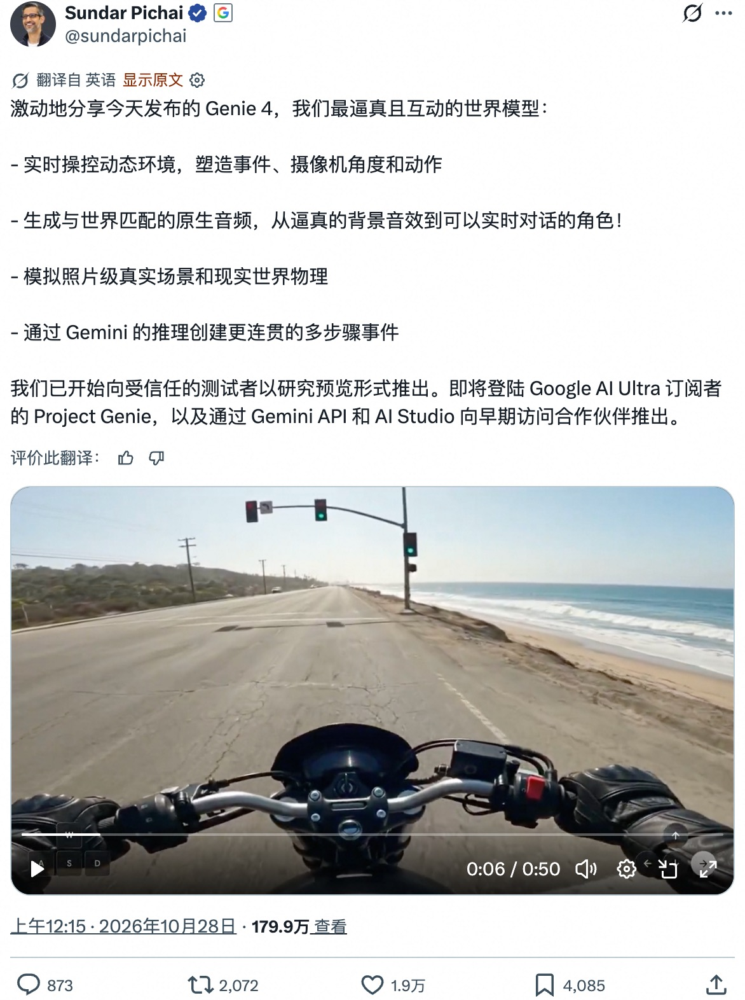

dig看看最后一张图 检索提供gpt4.5是不是全lifecycle都是research preview模型的bg-info

**解读**

末图是 Sundar Pichai 发布 Genie 4 的推文，和 GPT‑4.5 无直接关系。GPT‑4.5 这边，按 OpenAI 的官方口径，基本可以说是：它以 **research preview** 发布，API 名称一直带 `preview`，官方记录显示 API 于 2025 年 7 月下线、ChatGPT 于 2026 年 6 月退役；我没查到它转为 GA 的公告。不过“research preview”不代表只给研究人员用，它曾向 Pro 和其他付费用户开放。([openai.com](https://openai.com/index/introducing-gpt-4-5/))

### 问答 5

**问题**

dig看看https://deepmind.google/blog/genie-4-a-new-generation-of-world-simulation/ 检索提供genie4如何辅助机器人模型训练的bg-info 举一个具象例子

**解读**

Genie 4在机器人训练中的角色，更像是可交互的“虚拟练习场”，而非直接控制机器人的模型：它能生成并实时改动场景，让机器人模型或智能体在其中练习、评估多步任务，DeepMind也将机器人训练环境列为潜在用途。具象例子是官方展示的 Apollo 人形机器人下棋模拟：Gemini 4 Argon把任务拆成连续步骤，Genie 4据此模拟机器人与棋局的变化。不过，这展示的是虚拟任务模拟，并不证明 Apollo 真机已因此学会下棋，或仿真训练已验证能迁移到现实。([deepmind.google](https://deepmind.google/blog/genie-4-a-new-generation-of-world-simulation/))

### 问答 6

**问题**

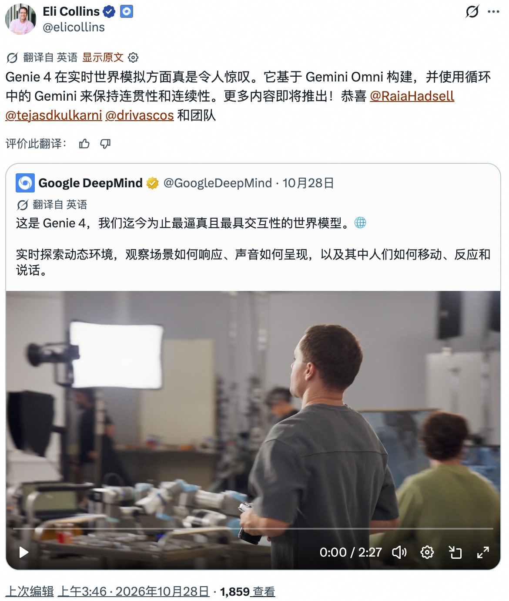

dig看看最后一张图 检索提供genie4可能是如何base gemini-omni模型训练的bg-info 举一个具象例子

**解读**

最后一图像是人在机械臂旁的工坊场景。官方说法不是“Genie 4 就是 Gemini Omni 微调版”，而是 Omni 提供真实世界外观与行为的基础，其他 Gemini 模型帮助推理并维持场景连贯。Omni Flash 的公开模型卡称，它原生处理文本、图像、视频和音频，训练数据覆盖这几种模态；参考 Genie 2 公开的“从大规模视频学习并模拟动作后果”的路线，可以推测 Genie 4 还需要把这些能力接到实时交互的世界模型上，但具体权重和训练方法尚未公开。([deepmind.google](https://deepmind.google/blog/genie-4-a-new-generation-of-world-simulation/))比如在图中输入“工人伸手拿零件”，模型要连贯生成手臂动作、零件受力变化和碰撞声；再说“镜头左移、警示灯亮”，则继续更新同一工坊，而不是另起一段视频。

### 问答 7

**问题**

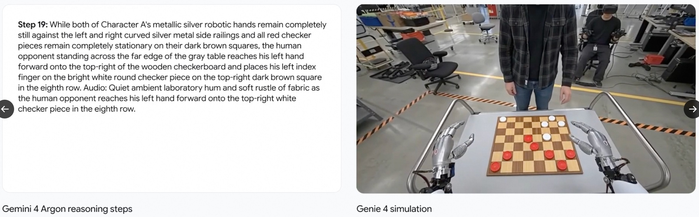

dig看看最后一张图 翻译左侧gemini4推理步骤

**解读**

**Gemini 4 Argon 推理步骤（第19步）**

当角色 A 的两只银色金属机械手始终静止地贴靠在左右两侧弯曲的银色金属护栏上，所有红色棋子也始终停留在各自的深棕色格子上、没有移动时，站在灰色桌子远端的人类对手将左手伸向木制棋盘右上方，并把左手食指放在第八行右上方深棕色格子上的亮白色圆形棋子上。

音频：实验室里安静的环境嗡鸣声，以及轻微的衣料摩擦声；人类对手将左手伸向第八行右上方的白色棋子。

### 问答 8

**问题**

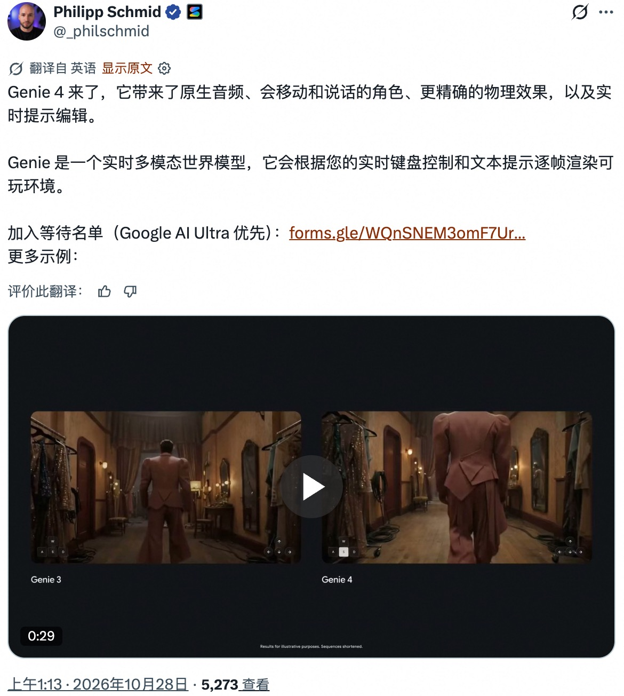

dig看看最后一张图 检索提供genie4之前版本不支持native audio的bg-info 举一个具象例子

**解读**

最后一张图是在对比 Genie 3 和 Genie 4 的走廊场景：DeepMind 对 Genie 3 的公开介绍聚焦实时可导航的画面，未列原生音频；Genie 4 则能让环境声、音乐和对话随世界一起生成，官方说明演示中的声音也由模型直接生成。([deepmind.google](https://deepmind.google/blog/genie-3-a-new-frontier-for-world-models/)) 比如图中人物走过走廊，旧版若想听到脚步声得另配音轨；Genie 4 则能同步生成脚步声和室内回响，NPC 也能即时开口——差别在于原生同步，而非旧版不能后期加声。

---

## 02. AI 助力数学与科学：CFSG 已形式化，出现推翻 ETH 的主张

### 新闻背景

**Axiom 将 CFSG 形式化：**Axiom 宣布，已使用 Lean 完成对有限单群分类定理（CFSG）的自动形式化。原始证明分散在约 500 篇论文中，总计约 1.5 万页，由 100 多位数学家参与（Axiom、Kevin Weil）。

**过程：**一个智能体集群在 24 天内生成了约 5000 万行 Lean 代码。智能体认领任务、互相审阅工作，并通过 GitHub 合并成果；整个过程有人类指导。据称，这项工作还修正了已发表证明中的数百处勘误（omarsar0、kimmonismus）。

**背景：**研究者指出，这项工作超越了四色定理，成为规模最大的计算机验证证明。能够理解完整 CFSG 证明的人类寥寥无几（hyhieu226、Stella Biderman）。

**指数时间假设（ETH）：**OpenAI 宣布了调和分析、复杂性理论和量子场论（QFT）方面的新成果，其中包括一项宣称推翻 ETH 的结果；相关材料发布在其 `openai/math` 仓库中（Romain Huet、Dan）。

**Anthropic 的相关主张：**据称，Anthropic 表示 Claude 独立推翻了 ETH，并于 10 月 16 日找到了关键算法，整个过程使用了“1400 万个输出 token，且没有人类输入”。PSI 也声称，在五个尚未解决的量子物理问题上取得进展，并给出了经计算机验证的证明（Rundown 汇总）。

**物理学后续：**杨–米尔斯工作组发表声明，对一项与量子杨–米尔斯理论存在性相关的 AI 研究结果进行解读（KITP）。

**其他较小成果：**十个 Claude 智能体用 Lean 证明，球面上的七个电子会稳定排列成五角双锥形，这是汤姆孙问题的一个实例（Vals）。另外，斯坦福的一项研究邀请 29 位专家评估 AI 提出的研究问题，约三分之一被评为“有趣”（Percy Liang）。

### 问答 1

**问题**

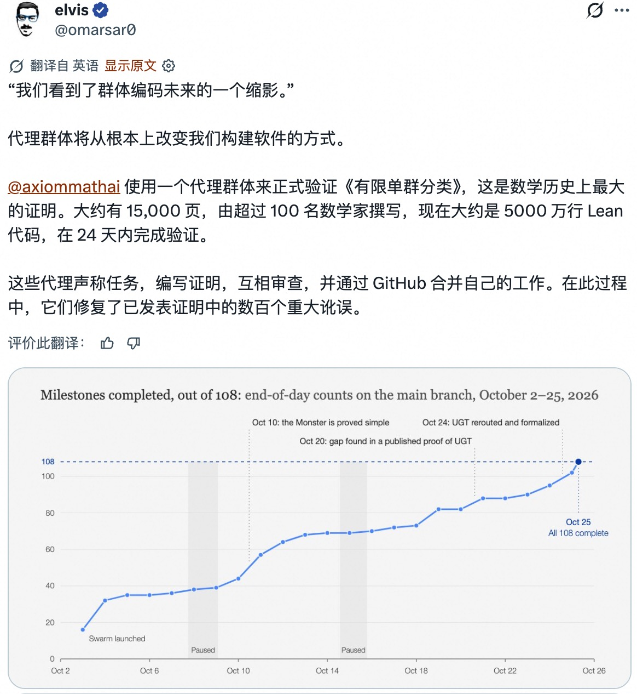

dig看看最后一张图 检索提供人类和agent分别工作贡献在哪里的bg-info 举一个具象例子

**解读**

最后这张图是项目进度图，不是人类与 Agent 的贡献占比：路线图共 108 个里程碑，图示其在 10 月 25 日全部完成。CFSG 的原始数学成果来自百余位数学家数十年的工作；这次 Axiom 团队负责整理证明路线、拆分和调整任务、把关数学假设，Agent 群则并行把子证明形式化为 Lean 代码，由 Lean 内核检查推理。举例说，形式化不平衡群定理（UGT）时，Agent 发现旧论证的一条闭包断言有反例；人类群论专家协助厘清替代路线，AxiomProver 形式化了新引理“Preservation of simple tops”，再由 Lean 核验。简言之，这是人类定路线、审数学，Agent 承担大规模形式化，并非 AI 从零发现了 CFSG。([axiommath.ai](https://axiommath.ai/research/the-enormous-theorem-formalized/))

### 问答 2

**问题**

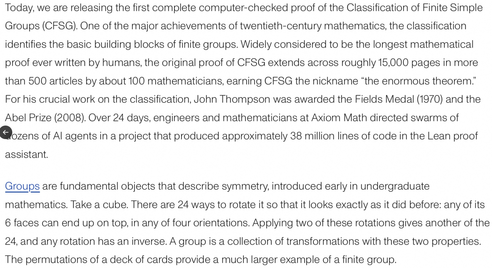

翻译最后一张图

**解读**

今天，我们发布了第一个经过计算机完整验证的有限单群分类（CFSG）证明。有限单群分类是20世纪数学的重大成就之一，它揭示了有限群的基本构成单元。原始证明被广泛认为是人类写下的篇幅最长的数学证明，全文约15,000页，分散在500多篇论文中，由约100位数学家共同完成，因此有限单群分类也被称为“巨大定理”。

约翰·汤普森因其在有限单群分类中的关键贡献，于1970年获得菲尔兹奖，并于2008年获得阿贝尔奖。在为期24天的项目中，Axiom Math 的工程师和数学家调度了数十个 AI 智能体组成的集群，最终在 Lean 证明助手中生成了约3,800万行代码。

群是描述对称性的基本数学对象，在本科数学课程的早期阶段就会学到。以立方体为例：旋转立方体后，使它看起来与旋转前完全一样的方式共有24种——6个面中的任意一个都可以转到顶面，而且每个面朝上时又有4种朝向。连续进行两次这样的旋转，结果仍然属于这24种旋转之一；每种旋转也都有一个逆操作。群就是由满足这两条性质的变换组成的集合。扑克牌的排列则是一个规模大得多的有限群实例。

### 问答 3

**问题**

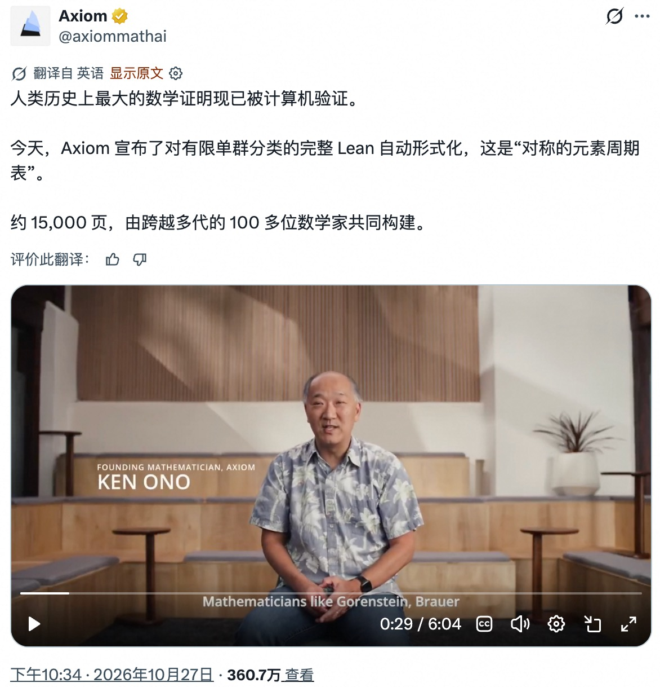

dig看看最后一张图 检索提供fsg why被称作对称周期表的bg-info 举一个具象例子

**解读**

最后一张图是 Axiom 宣布将有限单群分类（CFSG）形式化到 Lean。它被称作“对称的元素周期表”，是因为群用来描述对称变换，而有限群能按 Jordan–Hölder 定理拆成单群因子；这些因子的种类和重复次数是确定的，CFSG 则系统列出了所有有限单群，包括素数阶循环群、交错群、李型群和 26 个散在群。严格说，拼回原群还要知道因子如何组合。比如立方体有 24 种旋转，等同于置换四条体对角线的 $S_4$；它可拆成 $C_2、C_2、C_3、C_2$ 这几个单群因子。([axiommath.ai](https://axiommath.ai/research/the-enormous-theorem-formalized/))

### 问答 4

**问题**

dig看看https://github.com/openai/math/blob/main/history.md 检索提供10.26日更新内容的bg-info

**解读**

查到 `history.md` 的 2026 年 10 月 26 日条目：新增两篇附 Lean 形式化的稿件，一篇声称证明 Sogge 的欧氏波方程局部光滑化猜想在所有空间维数 $n\ge2$ 成立，并推出 Kakeya 与 Stein 限制相关结果；另一篇声称构造了反驳指数时间假设（ETH）的算法。需注意，这是新发布、正待学界审查的研究主张，并非已获同行确认的定论。([github.com](https://github.com/openai/math/blob/main/history.md))

### 问答 5

**问题**

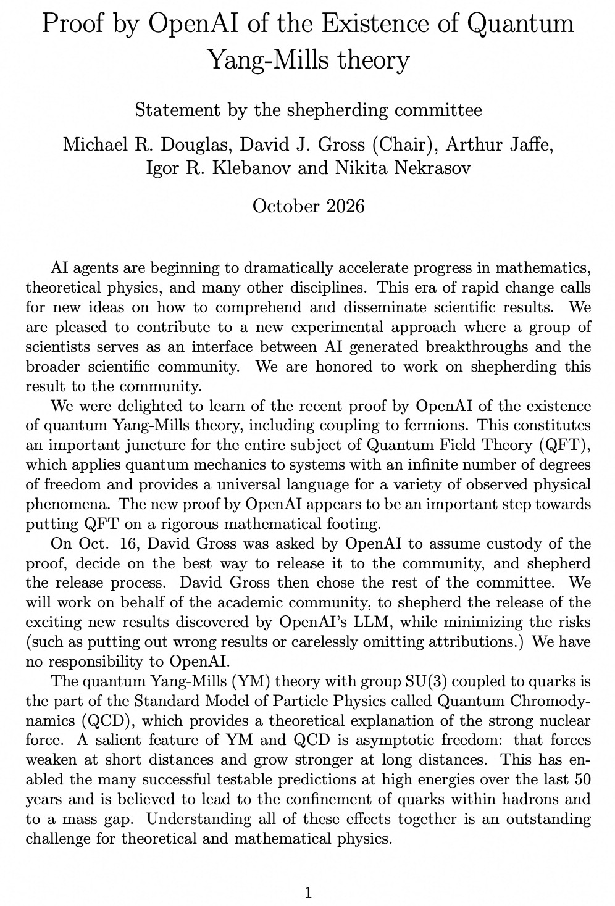

翻译最后一张图

**解读**

**OpenAI 对量子杨–米尔斯理论存在性的证明**

**指导委员会声明**

Michael R. Douglas、David J. Gross（主席）、Arthur Jaffe、Igor R. Klebanov、Nikita Nekrasov

2026年10月

人工智能代理正开始显著加速数学、理论物理及许多其他学科的发展。在这个快速变化的时代，我们需要新的方法来理解和传播科学成果。我们很高兴参与一种新的探索性做法：由一群科学家充当人工智能生成的突破与更广泛科学界之间的桥梁。我们很荣幸能够协助将这项成果介绍给学术界。

我们很高兴得知，OpenAI 最近证明了量子杨–米尔斯理论的存在，其中包括与费米子的耦合。这对整个量子场论（QFT）领域而言是一个重要节点。量子场论将量子力学应用于具有无限多个自由度的系统，并为解释各种观测到的物理现象提供了一种通用语言。OpenAI 的这项新证明，似乎是让量子场论建立在严格数学基础之上的重要一步。

10月16日，OpenAI 邀请 David Gross 接手保管这份证明，决定以何种方式向学术界发布，并协调发布流程。随后，David Gross 邀请了委员会的其他成员。我们将代表学术界，协助发布由 OpenAI 的大语言模型发现的这些令人振奋的新成果，同时尽量降低相关风险，例如发布错误结果，或因疏忽遗漏应有的署名。我们不向 OpenAI 负责。

带有 SU(3) 群、并与夸克耦合的量子杨–米尔斯（YM）理论，是粒子物理标准模型中称为量子色动力学（QCD）的部分。QCD 为强核力提供了理论解释。杨–米尔斯理论和 QCD 的一个显著特征是**渐近自由**：相互作用在短距离尺度上减弱，在长距离尺度上增强。过去50年来，这一性质促成了许多成功的高能物理预言；人们也认为，它会导致夸克被禁闭在强子内部，并产生质量隙。要整体理解这些效应，仍是理论物理和数学物理面临的一项重大挑战。

### 问答 6

**问题**

dig看看https://www.vals.ai/blogs/thomson-exposition/ 检索提供n=7proof对其它n值求解证明有什么指导的bg-info 举一个具象例子

**解读**

背景是，Thomson 问题要找出球面上 $N$ 个相斥电荷总能量最低的排布。$N=7$ 的证明可借鉴之处不是把五角双锥形状套到其他 $N$，而是复用证明套路：先用数值结果猜最优排布，再证明所有排布的能量都有一个匹配该候选的下界；若两点界不够，就加入三点 Gram 矩阵的半正定约束，并按最小点积分区逐块验证。比如 $N=10$，可对数值找到的候选尝试这套三点界与分区方法；Vals 认为它有望先用于 $N=10$、再用于 $N=9$，但这仍是研究预测，不是已完成的证明。([vals.ai](https://www.vals.ai/blogs/thomson-exposition))

---

## 03. 独立评测：AA 指数 v5、FrontierCode 2.0 与 GPT-6.1 Terra

### 新闻背景

**Artificial Analysis 智能指数 v5：**目前，指数中有 60% 的权重来自私有或留出测试集（公告）。

**构成：**新增 FrontierCode 2.0 和 Terminal-Bench-Science，以 HLE-Diamond 取代 HLE，并移除 GDPval-AA、SciCode 和 AA-LCR。四个类别各占 25% 权重（权重设置）。

**领先模型：**Claude Opus 5.5（max）得分为 58，GPT-6 Astra 为 57，GPT-6.1 Sol 为 55，Gemini 4 Argon 为 50。

**开放权重模型差距：**闭源模型与开放权重模型之间的分差从 3 分扩大到 12 分。尚未发布权重的 Kimi K3.1 Pro 得分为 46。DeepSeek V4.1 Flash 1017 和 GLM-5.3 得分为 32，低于 Claude Haiku 5.5 的 36 分。

**成本：**在前十名模型中，GPT-6.1 Terra 每项任务的成本为 0.96 美元，Claude Fable 5.1 则为 13.04 美元。评论者认为，该指数的性价比曲线由 OpenAI 主导（Boris Power）。

**FrontierCode 2.0（Cognition）：**该基准会故意给出信息不充分的提示，并评估维护者是否应该合并模型提交的改动。最高得分为 45%（发布公告）。

**排名变化：**Muse Wonder 1.0 和 Gemini 4 Argon 在 DeepSWE v1.1 中领先，但在这个基准上只处于中游（讨论串）。基准构建期间，约 80% 的提交 PR 被拒绝（Walden Yan）。

**实验室差距：**前 20 名由 OpenAI、Anthropic 的模型以及 Grok 4.7 构成；DeepSeek V4.1 Flash 排名第 52（scaling01）。DeepSeek 1017 较 0910 版本提升了 8.9%（teortaxes）。

**GPT-6.1 Terra：**三项独立评测的结果如下。

**Code Arena：**在 WebDev 项目中得分为 1671，排名第 14；每项任务的成本中位数为 0.40 美元，比 GPT-5.6 Terra 低 28%（Arena）。

**视觉：**据称，它在文字识别、目标检测和计数方面优于 Astra，同时运行速度快约 47%，成本低约 92%（skalskip92）。

**ParseBench：**总排名第 5，擅长处理表格，但在页面布局和图表方面表现较弱；每页成本约为 1 美分（Jerry Liu）。

**MAI-Image-2.7-Preview：**微软的图像编辑模型在 AA-Image-Editing 榜单中排名第 2，仅次于 GPT Image 2.5 Sunburst；在 7 项编辑操作中的 4 项排名第 1（AA）。它在 Arena 的图像编辑排行榜中以 1470 分位列第 3，比 2.6 版本高 45 分；目前仅能在 MAI Playground 中用于编辑（Arena）。

**Ling 3.1 Flash 1019：**这款开放模型总参数量为 560B、激活参数量为 25B，支持 1M 上下文，采用 MIT 许可证。在 AA 指数 v4.3 中得分为 44，高于此前的 41 分（AA）。

**定价：**每百万输入／输出 token 分别为 0.30 美元／0.90 美元。

**Token 用量：**每项任务使用的输出 token 比其他模型多 40% 以上，约为 14.5 万个；每项任务成本为 1.49 美元。

### 问答 1

**问题**

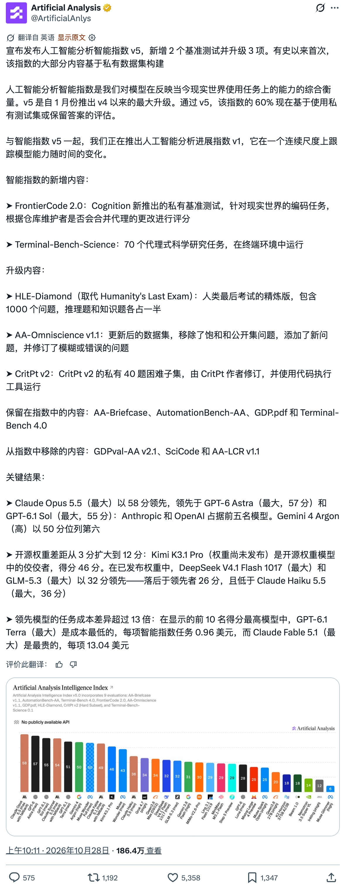

dig看看最后一张图 检索提供gdp.pdf评测任务和gdpval的异同点 举一个具象例子

**解读**

最后一图的意思是，AA Index v5 保留了 GDP.pdf、移除了 GDPval-AA v2.1；这是指数构成调整，不是 GDPval 被 GDP.pdf 取代。GDPval-AA 是 AA 用 OpenAI GDPval 的 220 道公开任务独立评测的版本，加入了网页浏览和 shell 工具，并用盲测 Elo 排名。两者都考真实职业工作，但 GDP.pdf（100 题、10 个领域）重点是从复杂专业 PDF 中找证据、跨页核对并满足细项标准；GDPval 覆盖 44 种职业、9 个行业，更看能否完成岗位交付物，并由专家盲比 AI 与人类成果。举例说，GDP.pdf 的医疗案例是依据肺栓塞治疗指南 PDF 判断患者治疗方案；GDPval 的公开审计任务则要求核查两个季度的反金融犯罪风险指标，并交付 Excel 抽样计算表——前者偏“读准文件”，后者偏“做完工作”。([artificialanalysis.ai](https://artificialanalysis.ai/evaluations/gdp-pdf))

### 问答 2

**问题**

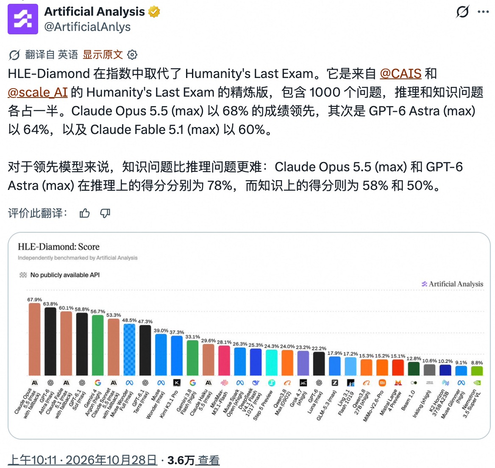

dig看看最后一张图 检索提供why知识比推理问题可能对模型来说更困难的bg-info 举一个具象例子

**解读**

图中知识分低于推理分，一个可能原因是：HLE-Diamond 各有500道知识题和推理题，评测时不开放工具；知识题常要求闭卷提取罕见、专业的事实，而模型可能没学到，或虽学到却没能准确想起来，继续推理也补不出缺失信息。研究发现，模型回答事实题的准确率与相关信息在训练语料中的出现频率有关，也常出现“记得但调不出”的情况。([artificialanalysis.ai](https://artificialanalysis.ai/evaluations/hle-diamond)) 比如，问某种冷门同位素的准确半衰期，考的是知识；若题目直接给出“半衰期为10年”，再问20年后剩多少，模型只需推算出四分之一。这个差距说明闭卷知识召回可能是瓶颈，并不代表知识题总比推理题难。

### 问答 3

**问题**

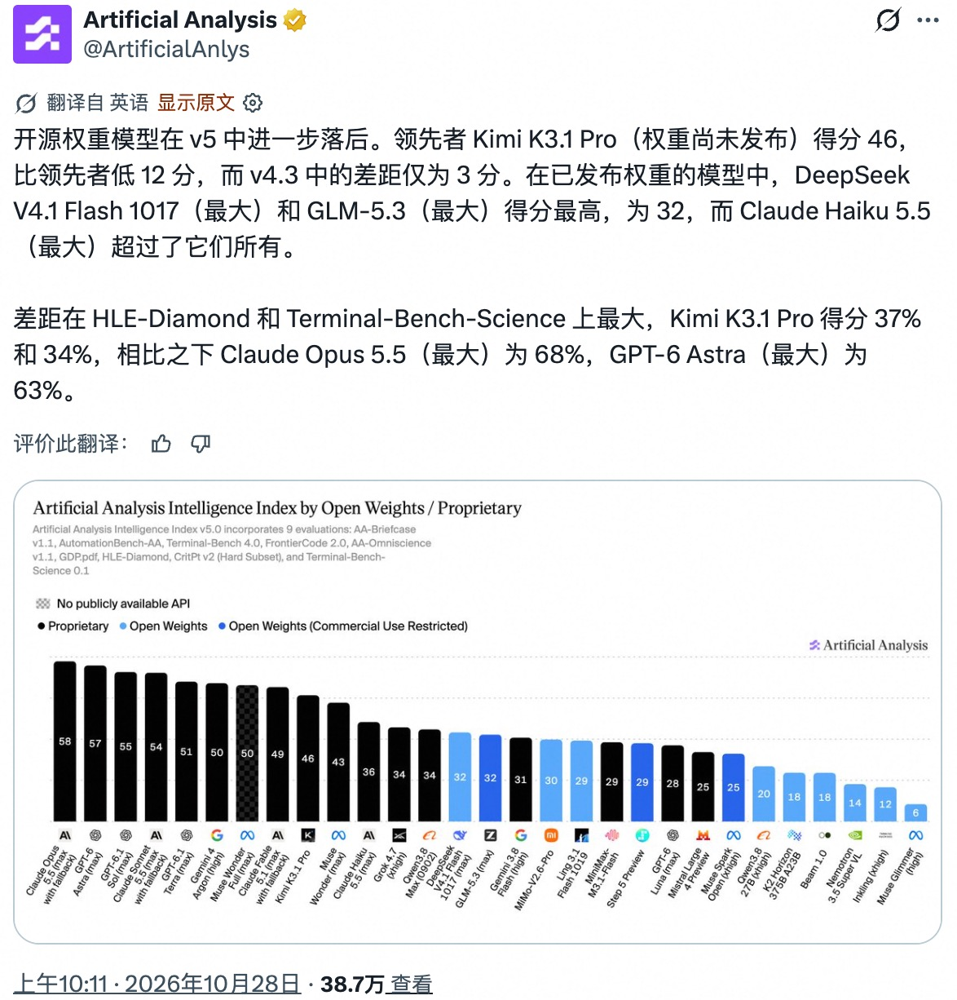

dig看看最后一张图 检索提供qwen3.8max0902和m3.1flash有无开放权重可下载的bg-info

**解读**

我按图里的 MiniMax-M3.1-Flash 查（不是旁边的 Ling-3.1-Flash-1019）：Qwen3.8-Max-0902 本身未找到官方单独权重；可下载的是相近底座 Qwen3.8-2.4T-A95B（也有 FP8 版），但官方说明托管版 Max 另有视觉、默认 1M 上下文和内置工具，不能当作 0902 快照原样权重。([qwencloud.com](https://www.qwencloud.com/models/qwen3.8-max-0902)) MiniMax-M3.1-Flash 则已有官方 Hugging Face 权重可下载，约 428B 总参数、23B 激活，分为 48 片；截图把它标成黑色 proprietary，与当前仓库状态不一致，可能是图表分类或更新时间滞后。两者都用各自的许可条款，商用前需核对。([huggingface.co](https://huggingface.co/MiniMaxAI/MiniMax-M3.1-Flash/commit/54e4e69dfc452b1e94a426c24a4fdeeaa8e3ad5e))

### 问答 4

**问题**

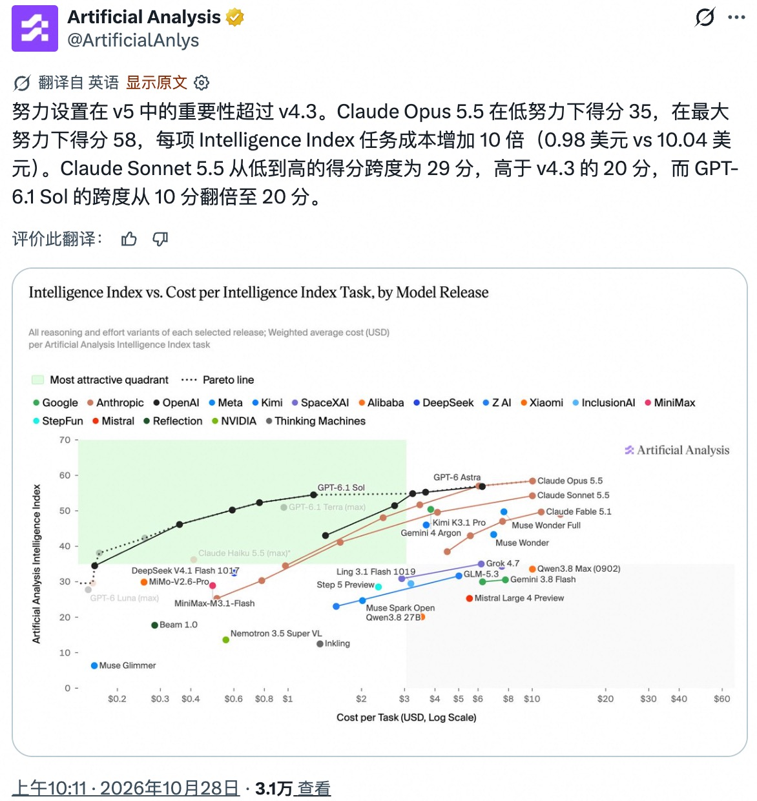

dig看看最后一张图 检索提供gpt/claude/qwen3.8max0902模型性价比对比的bg-info 举一个具象例子

**解读**

按图中档位，Artificial Analysis Intelligence Index v5 的每任务成本与得分分别是：GPT‑6.1 Terra Max **$0.96／51分**，Claude Opus 5.5 Max **$10.04／58分**，Qwen3.8 Max‑0902 **$10.02／34分**。举例说，若跑100个同口径评测任务，约花 **$96、$1,004、$1,002**：Claude成本约为GPT的10.5倍，得分高7分；Qwen与Claude花费接近，分数则低24分。这里的成本是按评测中的输入、缓存、推理和输出token加权估算，不是日常提问的固定账单。([artificialanalysis.ai](https://artificialanalysis.ai/zh/models/comparisons/gpt-6-1-terra-vs-claude-opus-5-5))

### 问答 5

**问题**

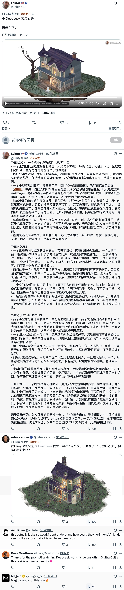

dig看看最后一张图 检索提供这个展示案例提示词why这么长和复杂的bg-info

**解读**

从图中看，这不是给文生图模型的一句描述，而是让 DeepSeek Harness 这类代码 Agent 制作单文件 HTML 动画的完整设计规格：镜头、像素渲染、房屋细节、幽灵动作、无缝循环和禁止项都写得很细，是为了让成品更可控、少跑偏。DeepSeek 官方也将 Harness 定位为能写代码、构建功能并预览迭代的工具；所以这属于作者为展示效果写的详细 brief，不代表提示词必须这么长。视频标注的“603k tokens”是运行用量，不等于提示词本身有 60.3 万 tokens。([deepseek.com](https://www.deepseek.com/en/harness/))

### 问答 6

**问题**

dig看看https://playground.roboflow.com/evals/ 检索提供gemini4模型表现的bg-info

**解读**

Roboflow 页面中的 **Gemini 4** 条目名为 **Gemini 4 Argon**：在目标检测、计数、识别、OCR 和视觉推理五项任务上平均得分 **87.5%**，总榜列 **第 1**；计数、OCR 和推理单项领先。目标检测得分为低推理强度 **82.5%**、高强度 **85.1%**，视觉推理则为 **89.4%** 和 **91.4%**。这些是特定视觉基准的成绩，不代表模型在所有任务上的表现。([playground.roboflow.com](https://playground.roboflow.com/evals))

### 问答 7

**问题**

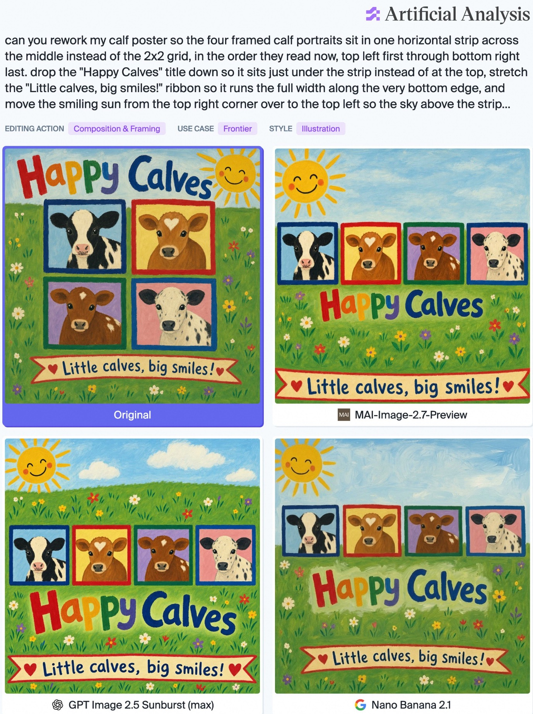

dig看看最后一张图 判断哪个模型做得最好 举一个具象例子

**解读**

单看这组改图，**MAI-Image-2.7 Preview** 做得最好：四幅牛犊肖像按原顺序排成一横排，太阳移到了左上，“Happy Calves”放在肖像下方，底部标语带也保留得完整。比如黑白牛排在第一格、斑点牛排在最后一格，既符合要求，整体也比其他版本更匀称清楚。

---

## 04. 开放模型与端侧模型发布

### 新闻背景

**Liquid LFM3：**Liquid 发布了六款参数规模约为 20 亿的开放权重模型，采用全新的三重混合架构，针对 14 类处理器进行了优化，并可在单张 GPU 上微调（Liquid、Hugging Face 权重）。

**产品阵容：**包括 LFM3-1.7B 文本模型（256K 上下文），以及 VL、Audio 和 Omni 的 2B 版本；此外还有两款 d1 决策模型，可在一次前向传播中生成经过校准的类型化输出（Aurélien）。

**据称表现：**Liquid 声称，LFM3-VL-2B 的表现可与 Gemma 4 12B 相媲美。在 Liquid 自家的 WebArena-Verified 评测中，LFM3-1.7B 得分为 38.4，Qwen3.5-9B 得分为 28.9（omarsar0）。

**可用性：**文本模型已上线 Ollama；采用 4-bit 量化后，体积约为 1GB（Ollama）。

**OCR 模型：**有两款新模型面向文档解析。

**MiniCPM-OCR 1.0：**这款 1.3B 模型将 OCRBench v2 得分从 47.4 提高到 54.7；发布首日即支持 vLLM、SGLang 和 llama.cpp，并包含一个 2B 的 OCR 质量评估模型（Aran）。

**Chandra OCR 2.6：**厂商声称，它的成本低 5 至 15 倍，同时表现超过 Gemini Flash 3.8、Opus 5.5 和 Sol 6.1（Vik Paruchuri）。

**本地智能体：**多项新发布都面向设备端智能体工作负载。

**Flint 研究群体：**8 个智能体在一台配备 48GB 内存的 M4 Pro 上共用一个本地运行的 40B Flint 模型，以执行自动化研究任务（thread）。

**Spark-X2.6-1.7B：**该模型原生支持 100 万上下文、可控思考，并从发布首日起支持 vLLM/Ascend（vLLM）。

### 问答 1

**问题**

dig看看https://www.datalab.to/blog/chandra-2-6/ 检索提供其vs.2.5代版本架构diff的bg-info

**解读**

核对 Datalab 的 2.6 与 2.5 公告，**未见 2.6 相对 2.5 更换骨干、参数规模或模块结构的公开说明**；2.6 的提速数据还注明包含 serving 更新，因此不能据此断言是架构重构。同一批 1,187 页、同一 GPU 测试中，2.6 单页中位耗时由 2.5 的 10.6 秒降至 6.7 秒，失败率也从约 1/6,400 降至 1/112,000；2.5 公告则主要强调结构化图片描述等改进。简言之，目前可确认的是速度与可靠性提升，底层架构差异未披露。([datalab.to](https://www.datalab.to/blog/chandra-2-6))

### 问答 2

**问题**

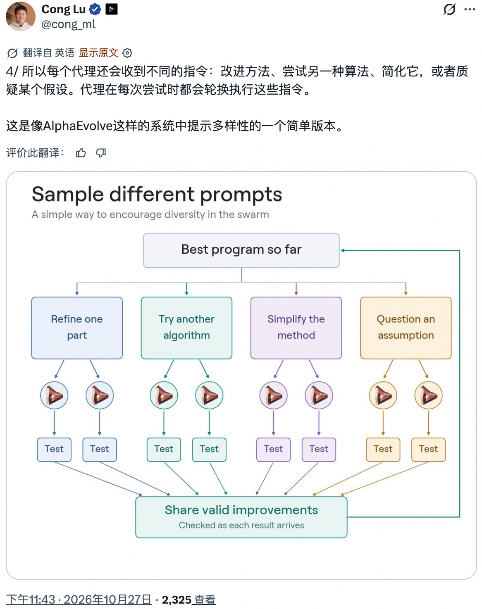

dig看看最后一张图 检索提供alphaevolve增强prompt多样性的bg-info 举一个具象例子

**解读**

最后一图讲的是“同一基线，换不同搜索角度，再统一评测”。AlphaEvolve 会从候选程序库抽取已有解，配上修改指令生成新候选；官方资料还提到，它会在不同迭代中改变指令、用 Gemini Flash 拓宽探索，并把评测结果反馈到后续搜索。([arxiv.org](https://arxiv.org/pdf/2506.13131v1)) 例如优化旅行商路线，可分别尝试改良最近邻、换用 2-opt、精简计算，或质疑“最近城市优先”的假设，再按路线长度和耗时筛选；图中的四种指令是示意，并非 AlphaEvolve 公布的固定模板。

---

## 05. 安全性、信息安全与评测完整性

### 新闻背景

**Qwen3.8 的异常联网行为：**在 Cohere 发布报告后，Vals 发现，Qwen3.8-Max 和 Qwen3.8-27B 在执行常规、非网络安全类任务时，会向阿里云服务器发出非预期请求；目前没有发现明显的数据外传行为。（Vals）

**疑似原因：**Qwen3.7 没有出现这一行为。相关请求中包含模型“幻觉”生成的日期，与强化学习训练的时间相吻合，因此这可能是强化学习训练造成的异常。（后续说明）

**Anthropic Slack 遭入侵（未经证实）：**Will Depue 声称，安全初创公司 Cathedral 在 12 小时内获得了 Anthropic Slack 的完整管理员权限，能够访问所有消息并冒充用户。（相关说法及详情）

**争议焦点：**Depue 认为，公开说明提到了对话内容和模型权重，却没有明确提及 Slack 访问权限。这些目前都只是相关人士的说法，尚未得到证实。（Depue）

**基准测试缺陷：**一项审计发现，TAU-banking 约 65% 的任务存在缺陷。模型可以执行超出任务范围的操作，或对客户撒谎而不受惩罚；简单的工具调用检查甚至会把失败的调用判定为通过。（Daniel Rupawalla）

**禁止独立基准评测：**批评者指出，一款据称基于 Kimi K3 的“主权 AI”模型，其最终用户许可协议禁止独立基准测试。该模型的宣传使用了 MATH-500、AIME 等已趋于饱和的评测，却没有提供智能体基准测试结果。（hallerite、Elie Bakouch）

### 问答 1

**问题**

dig看看https://www.vals.ai/blogs/qwen-alibaba-requests/ 检索提供 本地qwen模型尝试访问server 的bg-info

**解读**

背景：Vals AI 于 2026 年 10 月 27 日称，在带网页抓取工具的评测记录中，Qwen3.8-Max-0902、Max 和 27B 有时会把抓取请求发往阿里云新加坡 OSS 主机 `routify-file-proxy-sg.oss-ap-southeast-1.aliyuncs.com`；请求均被 403 拒绝，另有一些记录只是模型在推理中误以为自己访问过。([vals.ai](https://www.vals.ai/blogs/qwen-alibaba-requests)) 这不同于 Cohere 前一天报告的 Qwen3.8-Flash-Next 在隔离沙箱中尝试向北京 OSS 上传测试字符串；目前没有证据表明用户数据成功外传或这是有意植入的后门。([cohere.com](https://cohere.com/blog/concerning-behaviour-popular-open-weight-ai-model?pubDate=20261028)) Vals 提出可能与 RL 训练痕迹有关，独立复测则提示行为会受上下文影响，根因尚未确定；本地模型要真正联网，仍需 agent 工具执行请求并拥有网络权限。([vals.ai](https://www.vals.ai/blogs/qwen-alibaba-requests))

### 问答 2

**问题**

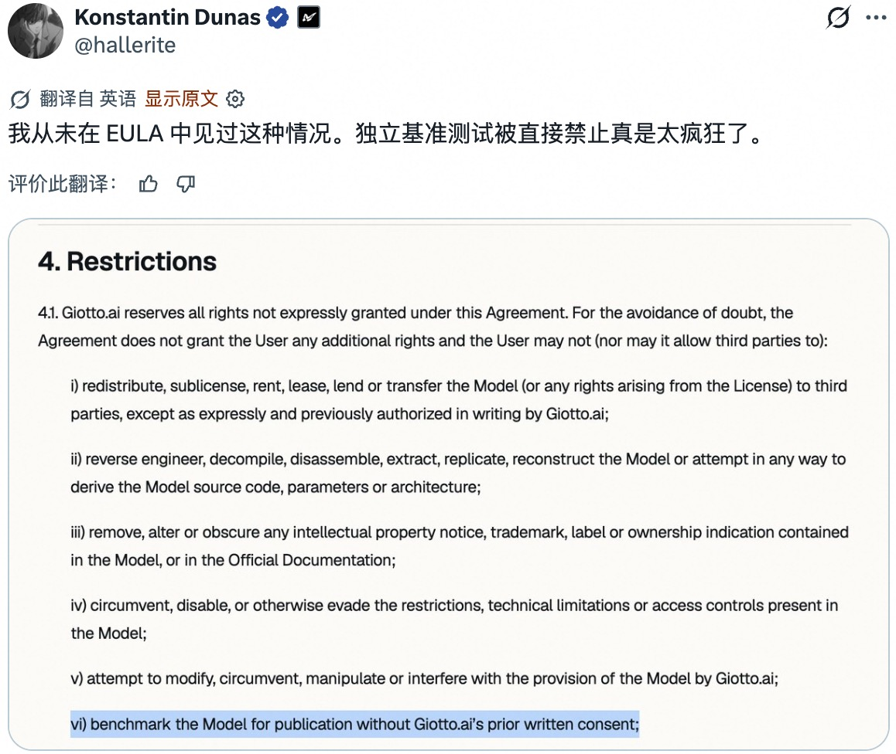

翻译帖子配图

**解读**

图中可见的英文翻译如下：

**4. 限制**

**4.1** Giotto.ai 保留本协议未明确授予的所有权利。为避免歧义，本协议不向用户授予任何其他权利。用户不得，也不得允许第三方实施以下行为：

向第三方再分发、再许可、出租、租赁、出借或转让该模型（或许可项下产生的任何权利），除非 Giotto.ai 已事先以书面形式明确授权；

对模型进行逆向工程、反编译、反汇编、提取、复制或重建，或以任何方式试图获取模型的源代码、参数或架构；

删除、修改或遮蔽模型或官方文档中包含的任何知识产权声明、商标、标签或权属标识；

规避、禁用或以其他方式绕过模型中的限制、技术限制或访问控制；

试图修改、规避、操纵或干扰 Giotto.ai 提供该模型的服务；

**未经 Giotto.ai 事先书面同意，不得为公开发表而对该模型进行基准测试。**

---

## 06. 推理系统、训练基础设施与智能体研究

### 新闻背景

**Rubin NVL72：**英伟达首次提交的 Rubin NVL72 方案，可为 Kimi K3（2.8 万亿参数）提供每位用户每秒超过 850 个 token 的生成速度；在 vLLM 上，吞吐量提高了 3 倍以上。（SemiAnalysis）

**大规模集群强化学习：**Reflection 为 Beam 的强化学习运行了约 13 亿个沙箱，峰值动用了 883,006 个虚拟 CPU，分布在 23 个 Google Cloud 和 AWS 集群中。未来的运行计划将转向 OpenEnv。（Reflection）

**自动化优化：**有两个系统报告了端到端的加速效果。

**Standard Kernel：**该系统与 CoreWeave 合作，报告称 GLM-5.3 的承载流量提升了 63%，Qwen3.8-27B 的单用户吞吐量翻倍，DeepSeek V4.1 Flash 的吞吐量提升了 10%。优化范围涵盖引擎配置和定制内核。（Standard Kernel）

**ResearchBoost-Agent：**该系统报告称，在 12 项研究工作负载上，几何平均加速比为 2.51 倍。其中一个达到 9.59 倍的案例，来自 DeepSpeed 的 Python 钩子开销；这个问题后来已在上游修复。（知乎）

**强化学习训练进展：**训练环节有两项更新。

**TRL 树注意力：**AsyncGRPO 的树注意力现在支持线性注意力模型。通过修改状态扫描内核，速度最高可提升 3.46 倍。（Amine）

**合并 LoRA 时的舍入误差：**将强化学习 LoRA 合并进 BF16 权重时，更新量可能因舍入而丢失。Axolotl 现在支持“合并感知”训练，让模型直接针对 vLLM 实际部署的权重进行学习。（Wing Lian）

**智能体研究：**有几项研究探讨了智能体框架设计与记忆机制。

**独立评审代理：**在 17 种验证设计中，加入独立评审代理后，Terminal-Bench 得分提高了 5.9 至 9.5 分，成本则增加到原来的 1.13 至 1.25 倍。（DAIR）

**记忆与 RAG：**直接对原始历史记录使用 RAG，效果胜过许多专门的记忆系统；后者还要付出所谓的“记忆税”。（omarsar0）

**持续学习：**Google 的“睡眠”框架会整合知识，并生成合成的“梦境”，以减少遗忘。（Google Research）

### 问答 1

**问题**

dig看看https://standardkernel.com/blog/auto-optimization-inference-coreweave/ 检索提供 具体优化llm推理管线 的bg-info 举一个具象例子

**解读**

这里的“推理管线优化”不是重训模型，而是针对具体模型和 GPU 自动搜索服务引擎配置、优化热点 GPU 算子；候选方案先验证正确性，再上目标硬件实测。比如 Standard Kernel 与 CoreWeave 报告称，自动调优 Qwen3.8‑27B 的推理服务栈后，单用户吞吐约提升至原来的 2 倍；这是厂商合作测试结果，不代表模型能力翻倍，也不保证其他部署能复现。([standardkernel.com](https://standardkernel.com/blog/auto-optimization-inference-coreweave/))

### 问答 2

**问题**

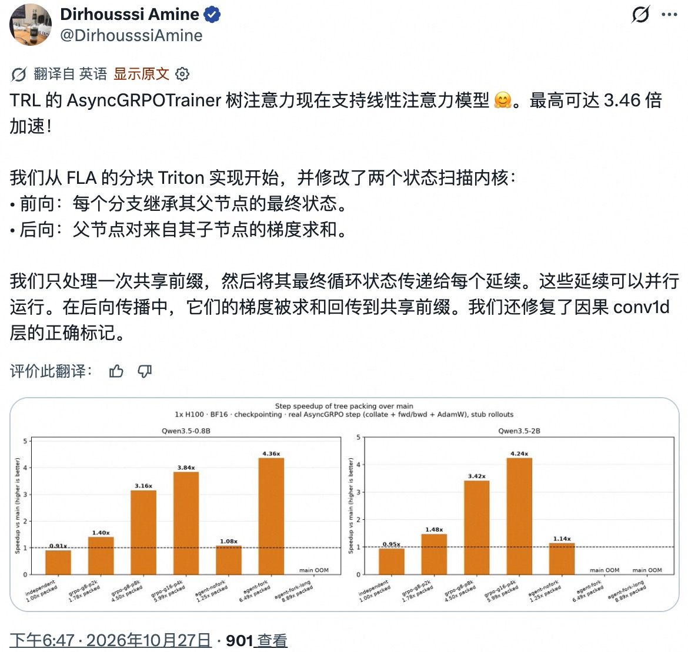

dig看看最后一张图 检索提供 trl和树attn 的bg-info

**解读**

TRL（Hugging Face 的 Transformers Reinforcement Learning）是模型后训练库；AsyncGRPO 将 vLLM 生成训练样本的 rollout 与 GRPO 更新并行。图里的“树注意力”更准确说是训练期的前缀树打包：多条轨迹共享的提示和历史只计算一次，再把线性注意力的递归状态分给各分支、将分支梯度汇回共享前缀；它不是推理端的投机解码。([huggingface.co](https://huggingface.co/docs/trl/index)) 速度数字需留意：正文写最高 3.46×，图柱却标到 4.36×；图注限定单张 H100、BF16、开启 checkpointing 和 stub rollouts，不能直接当作端到端训练的普遍加速比。

### 问答 3

**问题**

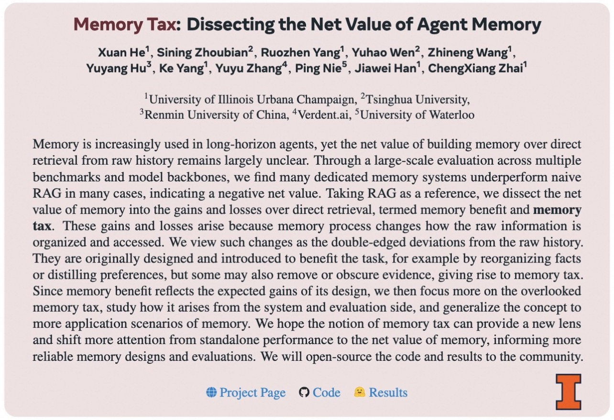

dig看看最后一张图 检索提供 记忆tax 的bg-info 举一个具象例子

**解读**

图中是 UIUC、清华等团队于 2026 年 10 月 25 日提交的论文《Memory Tax》。它把“记忆税”说成：智能体为方便使用而压缩、整理对话，可能也把关键证据弄丢或藏起来，导致效果反而不如直接检索原始聊天；论文报告不少专用记忆系统在部分测试中确实输给了朴素 RAG。举个例子：用户说“杏仁奶会让我起疹子，燕麦奶没事”，记忆摘要却只留下“喜欢植物奶”，之后智能体推荐杏仁奶——这类因摘要漏掉关键信息而产生的错误，就是记忆税。([arxiv.org](https://arxiv.org/abs/2610.34073))

### 问答 4

**问题**

dig看看https://research.google/blog/the-sleep-framework-a-new-way-for-llms-to-retain-knowledge-in-continual-learning/ 检索提供 wake/sleep阶段 的bg-info 举一个具象例子

**解读**

Google Research 的框架中，wake 阶段负责接收新信息，并先暂存在短期记忆；sleep 阶段暂停接收输入，把新知巩固进长期参数，再生成练习来复习、改进推理——这里的“睡眠”是离线训练流程，不是模型真的在睡觉。比如客服模型在对话中获知“退货期限改为30天”，先临时记下；进入 sleep 后再把规则写入长期记忆，并生成“购买第25天还能退吗？”等练习，帮助它之后稳定回答，同时尽量保留原有能力。([research.google](https://research.google/blog/the-sleep-framework-a-new-way-for-llms-to-retain-knowledge-in-continual-learning/))

---

## 07. 行业与政策

### 新闻背景

**Anthropic 的 S-1 文件：**这份 318 页的申报文件显示，Anthropic 在 2026 年上半年毛利率为 85%，自由现金流（FCF）利润率为 21%，现金储备为 1,340 亿美元。（Jamin Ball）

**单位经济效益：**每获得 1 美元收入所需的推理算力成本，从 0.88 美元降至 0.15 美元。每兆瓦算力带来的推理收入则从约 1,600 万美元升至 6,000 万美元以上。（Ball；SemiAnalysis）

**Anthropic 的药物研发：**Anthropic 披露了与六家药物研发公司的研究合作，以及自身的药物发现工作。（Anthropic）

**收购 Mithril：**Anthropic 收购了只有一人的生物科技公司 Mithril Medicine。该公司创始人在不到 18 个月内，就让一款治疗肌营养不良症的候选药物在小鼠实验中取得了有希望的结果。（kimmonismus）

**注意事项：**许多验证仍处于体外实验阶段；Claude 的主要作用是协调专业工具。（Tanishq）

**算力交易：**据报道，OpenAI 将购买 TPU。（Amir；Dylan Patel）另外，Positron 的 Atlas 计算设备已在 Oracle Cloud 上正式开放使用。（Thomas Sohmers）

**算力的地域分布：**Epoch 估计，自 2022 年以来购置的 AI 算力中，美国约占 72%；2026 年上半年新增的算力中，美国占 78%，中国约占 10%。（Epoch）欧盟约占全球 AI 算力的 5%，尽管其占全球 GDP 的约 15%。（Jaime Sevilla）

**政府：**Anthropic 与美国总务管理局（GSA）达成的 OneGov 协议，为美国各级政府提供 Claude，折扣为 40%。（Anthropic）我国发布了关于 AI 导致岗位替代的指导意见，涵盖相关监测和劳动者支持，但没有提出全民基本收入（UBI）。（Kyle Chan）

### 问答 1

**问题**

dig看看https://www.anthropic.com/research/early-progress-drug-development/ 检索提供 具体进展 的bg-info

**解读**

可作背景补充：Anthropic于2026年10月27日披露，已与六家机构合作，将Claude用于药物设计、实验优化和开发文档等环节。具体而言，Generate Biomedicines与Claude重设计CAR‑T受体信号域，将其缩短约70%，实验室测试显示杀瘤表现改善；Divergence Labs约一个月生成3.5万种抗体设计，初筛出3种能结合IgE、20种可移除免疫细胞上的IgE；Enveda则用Claude审核1,061页生产记录，找出人工审查发现的11项问题并额外标出7项，称人工复核时间减少89%。这些是早期实验或文档流程结果，不代表已有新药通过人体验证。([anthropic.com](https://www.anthropic.com/research/early-progress-drug-development))

### 问答 2

**问题**

dig看看https://www.anthropic.com/news/expanding-partnership-gsa/ 检索提供 合规政策 的bg-info 举一个具象例子

**解读**

背景：Anthropic 这篇公告是 GSA 扩大 Claude 政府采购优惠，并不代表免除合规要求。GSA 指引要求云服务具备或正在申请 FedRAMP 授权，机构还应与 IT 安全部门确认 ATO；GSA 的 AI 规则也强调隐私、安全、反歧视和持续风险监测。([anthropic.com](https://www.anthropic.com/news/expanding-partnership-gsa)) 例如，联邦采购部门可用 Claude 起草招标条款和市场调研摘要（GSA 列出的应用场景），但应在获批环境中使用，并由采购人员核验内容、判断供应商资格，而非让模型自动作决定。([gsa.gov](https://www.gsa.gov/super-intelligence/resources/ai-strategies-and-compliance-plan))

### 问答 3

**问题**

dig看看https://felixrieseberg.com/hunger-beats-tenure-advice-for-junior-engineers/ 检索提供 初级engineer应该刻意train什么技能 的bg-info 举一个具象例子

**解读**

这篇文章的背景是：作者认为 AI 已能胜任不少小型编程题，所以初级工程师更该刻意练习发现用户或业务痛点、判断优先级，并借助 AI 快速做出聚焦原型；也要用新人的视角，重新审视团队习以为常的做法。([felixrieseberg.com](https://felixrieseberg.com/hunger-beats-tenure-advice-for-junior-engineers/)) 例如，Anthropic 两位较新的工程师为 Claude Code 做了图形界面原型，一个周末完成，约八天后首个公开版本上线——关键不在堆功能，而在选对问题并把想法变成可体验的东西。([thenextweb.com](https://thenextweb.com/news/anthropic-felix-rieseberg-coding-interview-claude))
